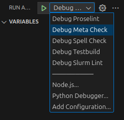

# Checks

This directory contains QA tests for the documentation.

All these checks are intended to run on the markdown files, not rendered files.

Tests should be made as Python scripts to allow flexibility of use. Currently these checks are run two ways:

- [GitHub Actions](https://docs.github.com/en/actions) as defined in [workflows](../.github/workflows/),
- [VSCode Problem Matchers](https://code.visualstudio.com/docs/editor/tasks#_processing-task-output-with-problem-matchers) as defined in [tasks.json](../.vscode/tasks.json).

By default every check exits `0` whatever it reports. Set `CHECKS_STRICT=1` to make a check exit `1` if it reported any warning or error
(notices do not count). This is intended for local use and AI agents, CI does not set it.

## Check Types

### Spellcheck

*This linter is defined in [run_spell_check.py](run_spell_check.py) script.*

Spellcheck pipeline settings can be modified in [.spellcheck.yml](../.spellcheck.yml).
Code (fenced and inline), macros, link targets and key names (`<kbd>Ctrl</kbd>`) are not checked.

List of custom words can be found in [dictionary.txt](../docs/assets/glossary/dictionary.txt),
however you **should not edit this manually**, see [adding-words-to-dictionary](../docs/CONTRIBUTING.md#adding-words-to-dictionary).

#### Limitations

Spellchecker does not provide output lineumber / column.
In order to get this a regex match is done on the markdown.
This means that you might occassionally see a word highlighted inside a context where it should be ignored (e.g. code block),
the typo is probably occuring elsewhere in the text in a valid context, fix it here and the first error will resolve.

### Prose Lint

*This linter is defined in [run_proselint.py](run_proselint.py) script.*

Checks text follows best practice for English language. Code blocks and inline code are skipped.

Individual rules can be disabled/enabled in [.proselint.json](../.proselint.json).

Our own rules, words and patterns that shouldn't appear in pages (old names, retired hostnames, generic headings,
placeholder image alt text, "here" as link text, the support email address, and non-preferred terms such as
"file system"), are listed in `BANNED_PATTERNS` in
[prose_rules.py](prose_rules.py). Each runs as a proselint check named `reannz.<name>`, at the level the entry gives
(only warnings fail `CHECKS_STRICT`), so one can be turned off in `.proselint.json` with `"reannz.<name>": false`.
To ban something new, add an entry there rather than writing a new check. An entry with `first_mention` allows a short
form ("WSL") once the full form has been used on the page.
An entry with `fix` says how to rewrite a match that needs no judgement ("file system" → "filesystem"). The check
adds it to its message, and [fix_prose.py](fix_prose.py) applies it: it prints a diff, or writes the fixes with `--apply`.
A single word that isn't English (`MyNeSI`, `GiB`, `hyperthreading`) doesn't need a rule: keep it out of the
nesi-wordlist dictionary and the spellcheck flags it. The preferred terms and what they replace are listed in
"Names and terms" in [FORMAT.md](../docs/FORMAT.md#names-and-terms).

### Markdown Lint

Checks markdown for compliance against general [best practice rules](https://github.com/markdownlint/markdownlint/blob/main/docs/RULES.md).

Individual rules can be disabled/enabled in [.markdownlint.json](../.markdownlint.json)

[parse_markdownlint.py](parse_markdownlint.py) skips MD032 (blank lines around lists) inside `<quiz>` blocks,
as the quiz syntax puts each answer's `> feedback` straight after it.

### Meta Checks

*This linter is defined in [run_meta_check.py](run_meta_check.py) script.*

Custom checks for page structure: front matter, titles, tags, nav, headings, sections, admonitions, code blocks and links.
Rules about the words on a page are in [Prose Lint](#prose-lint).

See script for details.

`code_line_length` is a notice rather than a warning in `out` and `txt` blocks, as real command output can't be rewrapped.

Admonitions (`!!!`, `???`) and content tabs (`===`) are checked here, not by markdownlint, which only understands CommonMark.
A body indented less than 4 spaces renders as an empty box without any build warning, so `admonition_structure` looks for that,
malformed openers, and admonition types with no style (Material's built-in types plus any `.admonition.<type>` in `docs/assets/stylesheets/`).

### Test Build

Does a 'strict' build of the site, capturing any errors emmited by mkdocs.

It rebuilds every page by default. `./checks/run_test_build.py --dirty` only rebuilds pages changed since the last build in `public/`,
which is faster (the VS Code task uses it) but drops warnings for skipped pages.
It also writes an incomplete `llms.txt`, so the `mkdocs_llmstxt` 'not found in the generated pages' warnings are hidden in that mode.

### Accessibility (WCAG)

*This linter is defined in [run_a11y_check.sh](run_a11y_check.sh), parsed by [parse_a11y_report.py](parse_a11y_report.py).*

Runs the [AccessLint](https://github.com/AccessLint/audit) WCAG audit against a local `mkdocs build` (the `public/` directory), rather than a deployed site, so it runs the same way in CI as it does locally.

Like the other checks, it can be scoped to specific pages by passing their `docs/*.md` source paths as arguments; with none given, every page in the site is audited.

AccessLint's own inline annotations only fire for violations with a JS/React source map, which a server-rendered mkdocs site never has, so `parse_a11y_report.py` reads its JSON report instead and maps each violation back to the built HTML file under `public/`.

## Errors and the PR summary

Only use `error` level for problems that should block merging, currently: a failed build,
broken links, macro or include errors ([run_test_build.py](run_test_build.py)) and front matter
that isn't valid YAML ([run_meta_check.py](run_meta_check.py)).
Checks exit non-zero if they emitted an error. Everything else should be a `warning` or `notice`.

In CI each check's output is saved and [summarise_annotations.py](summarise_annotations.py)
turns it into a single PR comment (posted by [pr_comment.sh](../.github/pr_comment.sh)).
Errors are always listed. Other findings are only listed if they are on a line the PR changed.
To preview locally, save each check's output to `annotations/<check>.txt` then run
`python3 checks/summarise_annotations.py origin/main annotations`.

### Debugging Checks

Each type of test has a debug job in VSCode.

Most will run on the [fail_checks](fail_checks.md) page

## Tags

Tags are used to help search indexing, but can also be used to search by topic.

We don't want a large number of similar/duplicate tag topics, as this is visually messy and reduces the utility of being able to sort by one.
There is a canonical vocabulary of tags (with aliases) in [tags.yml](../docs/assets/tags.yml), feel free to add to it.

Tags are checked in [run_meta_check.py](run_meta_check.py).
