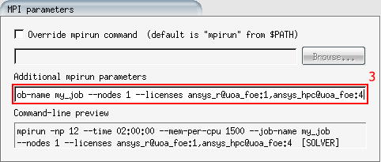

**[CLICK TO VIEW THIS PAGE RENDERED IN MKDOCS](https://nesi.github.io/support-docs/FORMAT/)**{ .hidden }

!!! prerequisite "See also"
    - To learn how you can contribute, [see CONTRIBUTING](CONTRIBUTING.md).
    - For information about page creation, [see NEWPAGE](NEWPAGE.md).
    - For what to write, and whether to write it, [see PRINCIPLES](PRINCIPLES.md).

This page is an overview of the naming conventions and Markdown syntax used in this documentation.

## Names and terms

- Call the organisation REANNZ.
- Call the platform Mahuika. After the first mention, "the cluster" is fine.
  Don't use "HPC3", which was a temporary name. "REANNZ HPC" is for policy pages, which define "REANNZ HPC Services".
- Only write NeSI where a name still carries it, for example `my.nesi.org.nz`, the support email address,
  hostnames, and the example project code `nesi99991`.
- For other terms, use the words in the [Glossary](GLOSSARY.md), so they match the tooltips.

Some terms are written several ways across the docs. Use the preferred form.
"After the first mention" means the short form is fine once the full one has been used on the page.

### Platform and services

| Write | Not |
| - | - |
| Mahuika ("the cluster" after the first mention) | `the HPC`, `our HPC`, `HPC3`, `REANNZ cluster`, `REANNZ platform`, `Mahuika HPC`, `Mahuika platform`, `Mahuika supercomputer`, `NeSI HPC`, `REANNZ HPC` (outside policy pages) |
| my.nesi.org.nz | `MyNeSI`, `my.nesi` |
| Mahuika OnDemand (OnDemand after the first mention) | `NeSI OnDemand`, `ondemand`, `On Demand`, `OOD`. Write Open OnDemand only for the upstream software. |
| Apptainer | `Singularity`, unless you mean the old name |
| Windows Subsystem for Linux (WSL after the first mention) | `WSL` before the full name |
| X11 forwarding | `X forwarding`, `X11-forwarding` |

### Accounts and logging in

| Write | Not |
| - | - |
| Mahuika user account (the account you log in to the cluster with) | `NeSI account`, `REANNZ HPC account`, `HPC account`, `Mahuika account` |
| username | `user name`, `user ID`, `userid`, `login name` |
| log in, log in to (verb). Login is the noun. | `login` (verb), `log into`, `log-in`, `log on`, `sign in` |
| multi-factor authentication (MFA after the first mention) | `two-factor authentication`, `2FA`, `multiple factor authentication`, `second-factor authentication`, `MFA` before the full name |
| additional authentication credentials | `second factor`, `authentication token` |
| 6-digit code | `6 digit code`, `6-digit number`, `one-time code`, `one-time password`, `OTP`, `second factor code` |
| authenticator app | `authentication app`, `authenticator application` |

### Projects and storage

| Write | Not |
| - | - |
| project code | `project ID`, `project number`, `account code` |
| project member | `team member` |
| project directory, home directory, subdirectory | `project folder`, `home folder`, `sub-directory` |
| filesystem | `file system`, `file-system` |
| long-term storage | `long term storage` |

### Jobs and computing

| Write | Not |
| - | - |
| batch script | `Slurm script`, `job script`, `submission script`, `submit script`, `sbatch script`, `batch file` |
| job array | `array job`, `Slurm array` |
| walltime | `wall time`, `wall-time`, `wall clock` |
| runtime | `run time`, `run-time` |
| FairShare or Fairshare | `fair share`, `fair-share`, `fairshare` |
| simultaneous multithreading (SMT after the first mention) | `hyperthreading`, `hyper-threading`, `SMT` before the full name |
| multithreading, multithreaded | `multi-threading` |

### General words

| Write | Not |
| - | - |
| set up (verb), setup (noun) | `setup` (verb), `set-up` |
| licence (noun), license (verb), licensed, licensing | `license` (noun), `licenced`, `licencing` |
| filename, hostname | `file name`, `host name` |
| website, webpage | `web site`, `web page` |
| 20 GB, 2 TB/s, 400 W (a space between the number and the unit) | `20GB`, `20G`, `2TB/s`, `400W` |
| GB, MB, TB (SI units) | `GiB`, `MiB`, `TiB`, `gibibyte` |

Leave labels copied from an interface as they are, for example a `User name:` field.

The prose check flags these old names and variant terms, outside announcements and release notes.
For MFA, WSL and SMT, it flags the short form only if it comes before the full one on the page.

## Headers

Headers should be surrounded by blank lines.

<h2>H2</h2>

```md
## H2
```

<h3>H3</h3>

```md
### H3
```

<h4>H4</h4>

```md
#### H4
```

Headers should have a blank line before and after.

Don't use `H1` (`#`) this is reserved for the page title. Setting a title here will change it in the nav also.

Don't start a page with a heading such as "Introduction" or "Overview": the text after the title is the introduction.

Make each heading say what its section is about, with the key word first.
Avoid generic headings such as "Description", "Details" or "Summary".
Start the heading of a task with a verb, for example "Connect with SSH".
Don't write headings as questions: they're hard to front-load, and readers want answers.

Write headings in sentence case: capitalise only the first word and proper nouns.
Page titles use Title Case instead, see [Article/Category Naming](NEWPAGE.md#articlecategory-naming).

These follow GOV.UK's [Create a clear structure](https://guidance.publishing.service.gov.uk/writing-to-gov-uk-standards/writing-guidelines/clear-structure/),
the UK Office for National Statistics guide to [structuring content](https://service-manual.ons.gov.uk/content/writing-for-users/structuring-content),
and Google's [Headings and titles](https://developers.google.com/style/headings).
The [GOV.UK Design System](https://design-system.service.gov.uk/styles/headings/) and
[Google](https://developers.google.com/style/capitalization) both use sentence case for headings.

h2 and h3 elements will be used to generate a table of contents (toc).

Try to keep headers short enough that they do not 'wrap' (become more than one line) in the toc.
The meta check warns when an `h2` is over 28 characters or an `h3` is over 26, but this will vary depending on the letters being used.

Header boundaries are also how the docs chat assistant splits pages into retrievable chunks, aiming for
roughly 400-3200 characters of body text per section. A section outside that band gets silently merged
into a neighbour or force-split on a paragraph boundary before being embedded.

## Line breaks

Put 2 spaces at the end of a line to force a line break.  
If you simply hit enter and don't use 2 spaces it will be considered one line.

```md
Put 2 spaces at the end of a line to force a line break.  
If you simply hit enter and don't use 2 spaces it will be considered one line.
```

Most markdown structures (lists, Admonitions, headers, code blocks, etc) should be surrounded by an empty line.
i.e. A newline before and after.
It is good practice to add a new line after every sentence, or when the line becomes too long.
This won't change how the text is rendered, but makes the source easier to read,
and a change to one sentence shows up as a change to one line in the diff ([Semantic Line Breaks](https://sembr.org/)).

## Text Emphasis

**bold**: `**bold**`

_italic_: `_italic_`

## Tab Containers

Tab Containers should be surrounded by blank lines.

=== "Tab One"
    something in the tab
=== "Tab two"
    something else

```md
=== "Tab One"
    something in the tab
=== "Tab two"
    something else
```

## Admonitions

Use admonitions sparingly. Too many, especially in a row, stop standing out and get skipped
(Google's guide to [notes and warnings](https://developers.google.com/style/notices)).
Keep `warning` and `danger` for real risk, such as lost data or a killed job.
Only put something in an `info` box if a reader who skips it will still succeed.

Admonitions should be surrounded by blank lines.

!!! warning
    A warning.

```md
!!! warning
    A warning.
```

### Admonition Titles

!!! info "Optional title"
    Admonition with optional title.

```md
!!! info "Optional title"
    Admonition with optional title.
```

Adding titles helps users find key information, however if you can't be bothered thinking of a good title,
refrain from using something unnecessary or non descriptive (e.g. `!!! info "More Information"`), better to leave titleless.
A good title also helps the docs chat assistant, which shows the admonition kind/title as a label
(e.g. `**Warning:**`) when it surfaces this section as a source.

Don't use a title if another Admonition already exists for that purpose (e.g. `!!! info "Watch out!"`).

### Collapsable Admonitions

Any Admonition can be made collapsable by replacing the `!!!` with `???` (closed), or `???+` (open)

??? info "I'm Collapseable"
    Wheeee

```md
??? info "I'm Collapseable"
    Wheeee
```

Consider making a Admonition collapsable-open (`???+`) if it is particularly long.
An Admonition **shouldn't be made collapsable-closed** (`???`) unless it has been given an **optional title explaining it's contents**.

### Admonition Flavours

There are various flavours.

!!! prerequisite
    - [link to page a user should read in order to follow](FORMAT.md)
    - some thing other requirement user must have to follow this page
    - usually you will want this to be a list format.
    - Should be right at the top of the page.

!!! tip "with title"
    For tangential actionable advice.  
    *`x` other command may be useful here.*

!!! info
    Use this to provide (optional) additional context or make an in depth explanation.
    *A little bit of info that isn't required for understanding the next paragraph.*

!!! warning
    Use this to draw readers attention to possible rare or edge case failures they may encounter.
    *If your filesystem is full you might get an error message.*

!!! danger
    Use this to draw attention to information that may lead to serious harm if ignored.
    *If your filesystem is full your job might be killed.*

!!! bug
    Mention possible bugs users may encounter (and tell them what to do if they encounter it).
    *Nearline doesn't work*

!!! deprecated
    Automatically added to pages with the `status:deprecated`, should be used when page is out of date.
    *This page is rubbish!*

!!! time "30 Minutes (for use in tutorial pages)"

!!! objectives
    - For use in tutorials
    - learning goal one.
    - learning goal two.

!!! keypoints
    - For use in tutorials
    - should summarise learning goal one.
    - should summarise learning goal two.

!!! postrequisite
    - For use in tutorials
    - should link to next lesson.

??? warning "Extra Admonitions you probably won't need"
    !!! note
        Use `info` instead of this.

    !!! question
        Havn't seen a reason to use this yet.
    
    !!! failure
        Havn't seen a reason to use this yet.
    
    !!! example
        Havn't seen a reason to use this yet.
    
    !!! quote
        Havn't seen a reason to use this yet.
    

## Code

### Block

Code blocks require a language lexer in order to do syntax highlighting, e.g. `python` ,`slurm`, `cuda`, `json`, `markdown`, `bash`
(most of these have short codes too, `py`,`sl`,`cd`,`md`,`sh`).
[A full list of lexers can be found in this list](https://pygments.org/languages/).
Code blocks should be surrounded by blank lines.

```py
import somepackage

formatting = True
if formatting:
    Print(formatting) # A comment
```

<pre><code><span>```py</span>
<span>import somepackage</span>
<span></span>
<span>formatting = True</span>
<span>if formatting:</span>
<span>  Print(formatting) # A comment</span>
<span>```</span>
</code></pre>

For plain text code blocks, still good to use a class as descriptor (e.g. `txt`, `stdout`, `stderr`).
May want to add formatting to this later.

<pre><code><span>```stdout</span>
<span>some code</span>
<span>```</span>
</code></pre>

```stderr
some code 
```

DON'T prefix a command with `$` (e.g. `$ ls`). Commands are easier to copy without it
([`markdownlint` rule MD014](https://github.com/DavidAnson/markdownlint/blob/main/doc/md014.md)).
If a prompt is ever wanted, it should be added through formatting, not text.

Keep code lines to about 80 characters, or the block scrolls sideways.
The meta check warns about longer lines (allowing a little more in admonitions and a little less in lists).
Google's guide to [code samples](https://developers.google.com/style/code-samples) uses the same limit.

Put a command and its output in separate blocks (the output as `txt`), so the command can be copied on its own.

### Values to replace

When a command or script needs the reader's own details, use the standard example values, so every page reads the same:

| Value | Example |
| ----- | ------- |
| Username | `username` |
| Project code | `nesi99991` |
| Project directory | `/nesi/project/nesi99991/my_data` |

For anything else, name the value in capitals with underscores, for example `INPUT_FILE`.
Don't use angle brackets such as `<username>`: copied unchanged, a shell reads `<` and `>` as redirects.
Don't use `XXXX` either.

Straight after the block, say what to replace, for example "Replace `nesi99991` with your project code."
For two or more values, start a list with "Replace the following:".
This follows Google's guide to [placeholders](https://developers.google.com/style/placeholders).

### Inline

This is some `echo "Inline Code"`.

<pre><code><span>This is some `echo "Inline Code"`.</span></code></pre>

Inline code does not have syntax highlighting.
Code should be used for any text that you want the user to copy exactly.

### Keyboard

Keyboard keys can be added using the `<kbd>` tag.

Press `<kbd>`ctrl`</kbd>` + `<kbd>`c`</kbd>` to copy text from terminal.

```md
Press <kbd>ctrl</kbd> + <kbd>c</kbd> to copy text from terminal.
```

Note the additional spacing around the `+` else it will appear cramped.

### Batch scripts

The most common use of a code block is to display an example batch script.  

We want our examples to be easy to understand, but also users _will_ copy
paste them, so we also want them to be working scripts that wont cause easily avoidable errors.

If possible stick to the following principles.

- Make sure the code block has the `sl` language tag. This will inform syntax highlight an CI checks.
- Use `#!/bin/bash -e` as your shebang.
- One blank line between shebang and Slurm Header.
- Use whitespace for your Slurm header delimiter (preferably aligned in a tidy way).
- Use the long form of Slurm options, e.g. `--job-name` rather than `-J`.
- Make sure to include `--job-name`, `--account` (`nesi99991`) and `--time`.
- One blank line after Slurm header.
- Always `module purge` before `module load`.
- Include version in `module load`. See [Variable Injection](#variables-injection) for convenience macro.
- Don't be too fancy. We all know you are very clever,
but your script examples should do the bare minimum needed to provide a safe example.
- If possible, include an example that will work for the user, e.g. one of the tutorial files. (`wget`, `$EB_ROOT`, etc)

#### Example

<pre><code><span>```sl</span>
<span>#!/bin/bash -e</span>
<span></span>
<span>#SBATCH --job-name          test-job</span>
<span>#SBATCH --account          nesi99991</span>
<span>#SBATCH --time             01:00:00 </span>
<span></span>
<span>module purge</span>
<span>module load MATLAB/{{ applications.MATLAB.default }}</span>
<span></span>
<span>matlab -batch "myScript"    # Some nice informative comment.</span>
<span>```</span></code></pre>

## Images

```md

```


!!! note "Pasting from Clipboard"
    You can 'paste' an image from the clipboard into a markdown document,
    it will add

    ```md
    
    ```

    In markdown where you pasted the image, and upload `image.png`, into the same directory.

    Make sure you rename the `image.png` to something more descriptive, move it into the 'assets/images' folder, and update then markdown accordingly.

    Write a real alt text too, not just the filename. The docs chat assistant has no way to see the
    image itself - the alt text is the only information it gets. The alt text should be written as if no image is visible at all.
    This is required by [WCAG 1.1.1 Non-text Content](https://www.w3.org/WAI/WCAG21/Understanding/non-text-content.html),
    and the prose check flags placeholders such as `alt text` or a file name.

!!! tip "Drag and Drop"
    You can easily get the path to a image file by dragging it from the left hand Explorer panel over your document, then pressing <kbd>shift</kbd> (you will be prompted) and dropping the image in the desired position. Copy pasting an image from Explorer into markdown also works.

    You can also start typing `!` and then use context suggestions (<kbd>ctrl</kbd> + <kbd>space</kbd>), select 'Insert Image' and navigate the rest of the way.

### Screenshots, diagrams and video

- Only use a screenshot when words can't do the job. Screenshots of web pages go out of date (see [Principles](PRINCIPLES.md#principles)).
- Crop screenshots to what matters, and check they don't show real usernames, project codes, email addresses,
  job IDs or file paths. The site is public.
- A Mermaid diagram has no alt text, so say what it shows in the text next to it
  ([WCAG 1.1.1 Non-text Content](https://www.w3.org/WAI/WCAG21/Understanding/non-text-content.html)).
- Only embed a video that has accurate captions ([WCAG 1.2.2 Captions](https://www.w3.org/WAI/WCAG21/Understanding/captions-prerecorded.html)),
  and give its `iframe` a `title` that says what the video is.

## Links

[External Link](https://example.com)

```md
[External Link](https://example.com)
```

[Internal Link](Storage/Filesystems_and_Quotas.md)

```md
[Internal Link](Storage/Filesystems_and_Quotas.md)
```

!!! warning
    Link paths are relative to the current file, and point at the `.md` file,
    for example `../Storage/Filesystems_and_Quotas.md` from a page in `Batch_Computing/`.
    Don't link to pages on this site with a full `https://docs.nesi.org.nz/...` URL.
    The build can't check those, so it won't catch a broken one (the meta check warns about them).

[Anchor Link](#links)

```md
[Anchor Link](#links)
```

`snake-case` anchors are automatically generated for all headers.

The anchor will be the same as the header text with all non-alphanumeric characters removed, converted to lower case, and space characters replaced with `-`.
For example a header `## This is my (nasty-Header)` can be linked to with the anchor `[Anchor Link](#this-is-my-nastyheader)`

!!! tip "Drag and Drop"
    You can drag files from the left hand Explorer panel over your document then press <kbd>shift</kbd> (you will be prompted) and drop in the desired position. Copy pasting a file from Explorer into markdown also works.

??? tip "Ambiguous links"

    Try to avoid putting links on ambiguous words. Link text should say where the link goes
    ([WCAG 2.4.4 Link Purpose](https://www.w3.org/WAI/WCAG21/Understanding/link-purpose-in-context.html)), e.g.

    === "Bad"
        View the software homepage [here](https://www.example.com).

        ```md
        View the homepage [here](https://www.example.com).
        ```

    === "Better"
        View the [software homepage](https://www.example.com).

        ```md
        View the [software homepage](https://www.example.com).
        ```

### Links to schedmd docs

Rather than linking the most up to date version of the Slurm docs, we want to link to the version used by our current Slurm.

Instead of

```md
[sacct](https://slurm.schedmd.com/sacct.html#lbAI)
```

Use

<pre><code>
[sacct](https://slurm.schedmd.com/archive/{{config.extra.slurm}}/sacct.html#lbAI)
</code></pre>


The version is set at build time from `docs/assets/slurm-limits.json`, which is fetched from
[modules-list](https://github.com/nesi/modules-list), so don't change it by hand.
If links to the Slurm docs break after a Slurm upgrade, check that the version is listed in the archive at `https://slurm.schedmd.com/archive/`.

## Tooltips

Only use a tooltip for extra detail. Tooltips show on mouse hover, so keyboard and touch users
[don't see them](https://www.tpgi.com/using-the-html-title-attribute-updated/).

[Hover over me](https://example.com "I'm a link with a custom tooltip.")

```md
[Hover over me](https://example.com "I'm a link with a custom tooltip.")
```

Acronyms should be automatically made tool-tips e.g. MPI.

```md
Acronyms should be automatically made tool-tips e.g. MPI.
```

## Lists

As with other markdown structures, lists must be surrounded by a blank line.

Indent nested items and continuation lines by 4 spaces. With fewer, the items render as one flat list.

### Unordered List

some text

- item1
- item2
- a
    multi-line
    item
- nested
    - items
        - nested-er

some other text

```md
some text

- item1
- item2
- a
    multi-line
    item
- nested
    - items
        - nested-er

some other text
```

### Ordered List

some text

1. item1
2. a
    multi-line
    item
    with multiple
    lines
3. nested
    1. nested item 1
    2. nested item 2
        1. even nested-er

some other text

```md
some text

1. item1
2. a
    multi-line
    item
    with multiple
    lines
3. nested
    1. nested item 1
    2. nested item 2
        1. even nested-er

some other text
```

*Note, nested list items use numbers, but will be rendered as whatever the indent is.*

## Tables

[Markdown Table Generator](https://www.tablesgenerator.com/markdown_tables), is a handy tool for complex tables/

Tables can be constructed using `|` to separate columns, and `--` to designate headers.

Number of dashes has no effect, things don't have to be lined up when in markdown, just looks nice.
Leading and trailing `|` are optional.

| Head   | Head   |
| ------ | ------ |
| Thing1 | Thing2 |
| Thing3 | Thing3 |

```md
 Head | Head
 --- | -----------
 Thing1 | Thing2
 Thing3 | Thing 3
```

`:`'s can be used to align tables.

| Left  | Centre | Right |
| :---- | :----: | ----: |
| Words | Words | Words |
| Words | Words | Words |

```md
| Syntax      | Description | Test Text     |
| :---        |    :----:   |          ---: |
| Header      | Title       | Here's this   |
| Paragraph   | Text        | And more      |
```

## Macros

Macros allow use of [Jinja filter syntax](https://jinja.palletsprojects.com/en/3.1.x/templates/) _inside the markdown files_ allowing for much more flexible templating.
More details can be found on the [mkdocs-macros-plugin page](https://mkdocs-macros-plugin.readthedocs.io/).

### Includes

The macro plugin allows the use of 'includes', here is an example.

```md



```

`````` fails soft in this project: if the included template errors while
rendering (e.g. an app is missing an expected field in module-list.json), that
include renders as nothing instead of taking out the whole page. No special
syntax needed - this is patched into both Jinja environments in `mkdocs_hooks.py`.

There are a few includes you may want to use.

| Path | content | usage |
| ---- | ------- | ----- |
| `````` | ```<a href="mailto:support@nesi.org.nz">Contact our Support Team</a>``` | Anywhere the user is told to contact support. |
| `````` | Description, homepage, warnings, module versions and licences for an application | At the top of pages in `Software/Available_Applications/`, inside the "apps page boilerplate" (needs `app_name` and `app` set first) |
| `````` | List of network licences | When dynamic licence info is required (used in `app_header.html`)  |
| `````` | List of versions and a 'module load' code-block. | When dynamic version info is required |

### Variables injection

Here is an example using dynamically using the module version information.

```sh
module load ANSYS/{{ applications.ANSYS.default }}
```

```md

```sh
module load ANSYS/{{ applications.ANSYS.default }}
```

```

### Advanced Macros

And here is another example showing all Python packages installed in Python modules.

??? "Fancy Example"
    Our Python modules come pre-built with the following packages:
    <table>
    <tr><th>Package</th></tr>
    
    <tr><td>{{ pyext }}</td></tr>
    
    </table>

    ```md
    
    Our Python modules come pre-built with the following packages:
    <table>
    <tr><th>Package</th></tr>
    
    <tr><td>{{ pyext }}</td></tr>
    
    </table>
    
    ```
