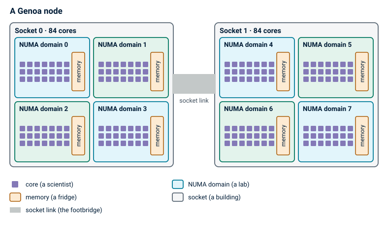
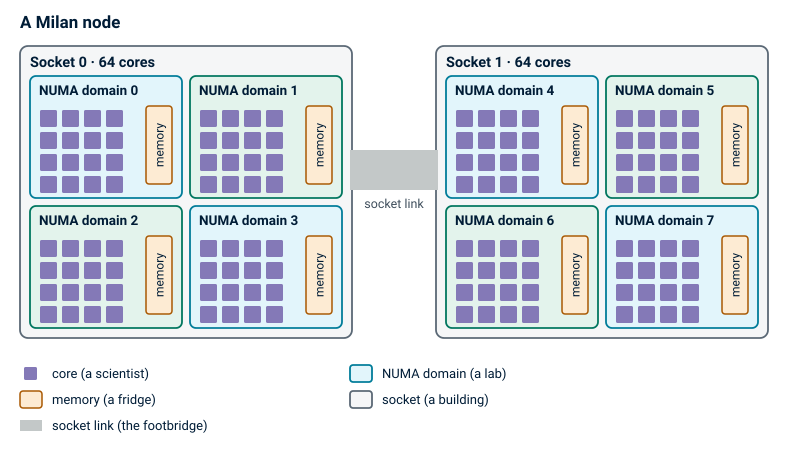

Inside a Mahuika node, some of the memory is closer to some of the cores than the rest.
If a job's work and its data end up far apart, the job can run slower than it should,
and its runtime can change from one run to the next.

## Cores and memory

Mahuika is made up of many nodes (individual computers). Your job runs on one or more of them.

The two parts of a node that matter here are its cores and its memory.
Cores do the calculations.
Memory holds the data the cores are working on.
A core has to fetch each number from memory before it can use it.

To use more than one core at once, a program splits its work into pieces.
A multithreaded program, such as one that uses OpenMP, runs several threads.
An MPI program runs several tasks, and these can be spread across more than one node.
Each thread or task runs on its own core.

When you submit a job, you ask Slurm for some cores and some memory, and Slurm decides which ones you get.

## Near and far memory

Fetching data from memory takes time, and how long depends on where the data is.

Picture a node as two buildings joined by a footbridge.
Each building has four labs, and each lab has a few scientists and a fridge full of samples.
The scientists are the cores, and the fridges are the memory.

A scientist who needs a sample gets it fastest from the fridge in their own lab.
Fetching one from a lab down the corridor takes longer,
and fetching one from the other building, across the footbridge, takes longest of all.


In a node, each lab is a NUMA domain: a group of cores along with the part of the memory closest to them.
NUMA is short for [non-uniform memory access](https://en.wikipedia.org/wiki/Non-uniform_memory_access),
which means that some memory takes longer to reach than other memory.

## NUMA domains on Mahuika

A real node is laid out the same way.
The two buildings are the node's two sockets, each holding one processor chip,
and the link between the sockets does the job of the footbridge.



A Genoa node has 2 sockets of 84 cores.
Each socket is split into 4 NUMA domains, so the node has 8 NUMA domains with 21 cores each.
The memory is shared out evenly between them.
On a node with 384 GB, each NUMA domain has about 47 GB, after a little is kept back for the operating system.

Milan nodes are split the same way, into 8 NUMA domains, but with 16 cores in each.
On a Milan node with 512 GB, each NUMA domain has about 63 GB.



## NUMA domains by node type

The table below lists every type of node. [Hardware](../../Batch_Computing/Hardware.md) has more about each one.

<table>
    <thead>
        <tr><th>Node type</th><th>Processors</th><th>Cores</th><th>Memory</th><th>NUMA domains</th><th>Cores per domain</th><th>Memory per domain</th></tr>
    </thead>
    <tbody>
        <tr><td>Genoa compute</td><td>2 x AMD Genoa 9634</td><td>168</td><td>384 GB</td><td>8</td><td>21</td><td>~47 GB</td></tr>
        <tr><td>Genoa GPU (RTX PRO 6000)</td><td>2 x AMD Genoa 9634</td><td>168</td><td>768 GB</td><td>8</td><td>21</td><td>~94 GB</td></tr>
        <tr><td>Genoa GPU (H100 or L4)</td><td>2 x AMD Genoa 9634</td><td>168</td><td>1536 GB</td><td>8</td><td>21</td><td>~189 GB</td></tr>
        <tr><td>Genoa large memory</td><td>2 x AMD Genoa 9634</td><td>168</td><td>1536 GB</td><td>8</td><td>21</td><td>~189 GB</td></tr>
        <tr><td style="border-top: .25rem double">Milan compute</td><td style="border-top: .25rem double">2 x AMD Milan 7713</td><td style="border-top: .25rem double">128</td><td style="border-top: .25rem double">512 GB</td><td style="border-top: .25rem double">8</td><td style="border-top: .25rem double">16</td><td style="border-top: .25rem double">~63 GB</td></tr>
        <tr><td>Milan large memory</td><td>2 x AMD Milan 7713</td><td>128</td><td>1024 GB</td><td>8</td><td>16</td><td>~126 GB</td></tr>
        <tr><td>Milan GPU (A100 80 GB), <code>mg13</code> to <code>mg16</code></td><td>1 x AMD Milan 7713P</td><td>64</td><td>512 GB</td><td>4</td><td>16</td><td>~126 GB</td></tr>
        <tr><td>Milan GPU (A100 40 GB), <code>mg17</code> to <code>mg19</code></td><td>2 x AMD Milan 7413</td><td>48</td><td>512 GB</td><td>8</td><td>6</td><td>~63 GB</td></tr>
        <tr><td style="border-top: .25rem double">Intel large memory (<code>hugemem</code>), <code>cl18</code> and <code>cl19</code></td><td style="border-top: .25rem double">2 x Intel Xeon Gold 6230</td><td style="border-top: .25rem double">40</td><td style="border-top: .25rem double">1.5 TB</td><td style="border-top: .25rem double">2</td><td style="border-top: .25rem double">20</td><td style="border-top: .25rem double">~755 GB</td></tr>
        <tr><td>Intel large memory (<code>hugemem</code>), <code>cl17</code></td><td>4 x Intel Xeon Gold 6238M</td><td>88</td><td>6 TB</td><td>4</td><td>22</td><td>~1.5 TB</td></tr>
    </tbody>
</table>

Memory is the memory installed, as on the Hardware page.
Each NUMA domain has a little less than an even share of it, because some is kept back for the operating system.
Slurm also keeps 2 cores on each node for the system, so on a Genoa node, for example, jobs can use 166 of the 168 cores.

## Your desktop and Mahuika

You've probably never had to think about NUMA domains on your own desktop or laptop.
Most of them have one processor, and all of their memory is the same distance from every core.
In the story, that's one small lab with one fridge, so every sample is close at hand.

![A desktop processor and a Genoa node, drawn to the same scale. The desktop has one processor, about 4 cm across, with four memory slots on one side, all wired to the same part of the processor, so every core reaches the memory the same way and there is one NUMA domain. The Genoa node has two processors, each about 7.5 cm across and joined by a link, with six memory slots on each side of each processor. Each quarter of a Genoa processor, with its chips of cores and the memory slots wired to it, is one NUMA domain, so the node has 8.](../../assets/images/NUMA_Domains_Desktop_vs_Genoa.svg)

Mahuika's nodes are different in a few ways that can make NUMA domains matter.

- They're physically much bigger. A Genoa node has two large processors with 168 cores between them.
  The memory slots surround each processor, and each slot is wired to the part of the processor on its side,
  so the cores on that side reach it fastest.
  Memory attached to the other processor is further still, as data from it has to cross the link between the two processors.
  Every extra step on the way adds a little time.
- You often share them. Unless your job uses a whole node, other people's jobs run on the rest of it.
  Slurm gives your job cores from whatever is free, and they can end up spread over several NUMA domains.
- Jobs often run for much longer. Say a job runs 20% slower than it could.
  On your laptop, a program that takes a minute would finish 12 seconds later, and you'd never notice.
  On Mahuika, a job that takes two days would finish nearly ten hours later.
- Time on Mahuika is counted. A slower job uses more of your project's
  [allocation](../../Getting_Started/Allocations/What_is_an_allocation.md), and takes longer to give you results.

## When NUMA domains matter

Even on Mahuika, most jobs never need to think about NUMA domains.
They make a difference for programs that run many threads or MPI tasks and move a lot of data in and out of memory.
These jobs usually lose time in one of two ways.


**The first is when the job's cores are spread over several NUMA domains.**
Linux stores each piece of data in the memory of the NUMA domain whose core first uses it,
so the job's data ends up spread over the memory of several domains.
Whenever a core needs data that's stored in another domain, the fetch takes longer.
Slurm doesn't guarantee that a job's cores are all in one NUMA domain, even when they would fit in one.


**The second is when a thread moves.**
To keep all of your job's cores evenly busy, the operating system can move a thread from one core to another.
If the new core is in another NUMA domain, the thread's data stays behind in the old domain's memory.
From then on, every fetch of that data comes from another domain's memory.

If your job's runtime changes a lot between runs with the same input, one of these may be the reason.

## Check a job's NUMA domains

To see which cores each task of your job is using, and which NUMA domains they're in,
put this command in your batch script before the line that runs your program:

```sh
srun --job-name=print_binding_stats bash -c "echo -e \"Task #\${SLURM_PROCID} is running on node \$(hostname).\n\$(hostname) has the following NUMA configuration:\n\$(lscpu | grep -i --color=none numa)\nTask #\${SLURM_PROCID} has \$(nproc) CPUs, their core IDs are \$(taskset -c -p \$\$ | awk '{print \$NF}')\n===========================================\""
```

Each task prints a report like this one, from a task on a Genoa node:

```txt
Task #0 is running on node c001.
c001 has the following NUMA configuration:
NUMA node(s):                            8
NUMA node0 CPU(s):                       0-20,168-188
NUMA node1 CPU(s):                       21-41,189-209
NUMA node2 CPU(s):                       42-62,210-230
NUMA node3 CPU(s):                       63-83,231-251
NUMA node4 CPU(s):                       84-104,252-272
NUMA node5 CPU(s):                       105-125,273-293
NUMA node6 CPU(s):                       126-146,294-314
NUMA node7 CPU(s):                       147-167,315-335
Task #0 has 4 CPUs, their core IDs are 8-11
===========================================
```

In this report, a CPU is a core, and a NUMA node is a NUMA domain, not a whole node.

- The `NUMA node` lines list the cores in each NUMA domain.
  For example, NUMA domain 0 has cores 0 to 20.
  The numbers 168 to 188 are the same 21 cores again, as each core can run two threads at once
  (see [Simultaneous Multithreading](Simultaneous_Multithreading.md)).
- The last line lists the cores the task can use, here cores 8 to 11.

To find a task's NUMA domains, look for its cores in the `NUMA node` lines.
Cores 8 to 11 are all in NUMA domain 0, so this task is in one NUMA domain.
A task with cores 19 to 22 would be spread over two:
cores 19 and 20 are in NUMA domain 0, and cores 21 and 22 are in NUMA domain 1.

## Nomenclature confusion in Slurm: Sockets

Earlier on this page, a socket is the part of a node that holds one processor chip.
A Genoa node has 2 sockets, each with 84 cores split into 4 NUMA domains.

Slurm uses the word differently on Mahuika.
It treats each NUMA domain as a socket, so it shows a Genoa node as 8 sockets of 21 cores, rather than 2 sockets of 84.
So when a Slurm option or Slurm's output mentions sockets, it means NUMA domains.
For example, `--cores-per-socket 21` in the batch scripts below asks for a node whose NUMA domains have at least 21 cores.

## Navigating NUMA domains on Mahuika

The example batch scripts below keep a job's work close to its data.
Slurm puts the tasks next to each other, filling one NUMA domain before starting on the next.
On a GPU node, the tasks also stay in the NUMA domain the GPU is attached to.

[What the options mean](#what-the-options-mean) explains the options that keep tasks and threads in their NUMA domains.
[OpenMP Settings](OpenMP_Settings.md) and [Thread Placement and Thread Affinity](Thread_Placement_and_Thread_Affinity.md)
go into more detail.

=== "Genoa"

    A Genoa node has 8 NUMA domains of 21 cores.
    The GPUs are in NUMA domains 1 and 7 (RTX PRO 6000), 5 and 7 (H100), or 1, 3, 5 and 7 (L4).

    === "Compute"

        ```sl
        #!/bin/bash -e

        #SBATCH --job-name         numa-mpi
        #SBATCH --account          nesi99991
        #SBATCH --time             01:00:00
        #SBATCH --partition        genoa
        #SBATCH --ntasks           8
        #SBATCH --cpus-per-task    1
        #SBATCH --mem-per-cpu      2G
        #SBATCH --cores-per-socket 21
        #SBATCH --threads-per-core 1
        #SBATCH --distribution     *:block:*
        #SBATCH --mem-bind         local

        export OMP_PROC_BIND=true
        export OMP_PLACES=cores

        srun --job-name=print_binding_stats bash -c "echo -e \"Task #\${SLURM_PROCID} is running on node \$(hostname).\n\$(hostname) has the following NUMA configuration:\n\$(lscpu | grep -i --color=none numa)\nTask #\${SLURM_PROCID} has \$(nproc) CPUs, their core IDs are \$(taskset -c -p \$\$ | awk '{print \$NF}')\n===========================================\""

        srun MY_PROGRAM
        ```

    === "Large memory"

        ```sl
        #!/bin/bash -e

        #SBATCH --job-name         numa-mpi
        #SBATCH --account          nesi99991
        #SBATCH --time             01:00:00
        #SBATCH --partition        genoa
        #SBATCH --ntasks           8
        #SBATCH --cpus-per-task    1
        #SBATCH --mem-per-cpu      8G
        #SBATCH --cores-per-socket 21
        #SBATCH --threads-per-core 1
        #SBATCH --distribution     *:block:*
        #SBATCH --mem-bind         local

        export OMP_PROC_BIND=true
        export OMP_PLACES=cores

        srun --job-name=print_binding_stats bash -c "echo -e \"Task #\${SLURM_PROCID} is running on node \$(hostname).\n\$(hostname) has the following NUMA configuration:\n\$(lscpu | grep -i --color=none numa)\nTask #\${SLURM_PROCID} has \$(nproc) CPUs, their core IDs are \$(taskset -c -p \$\$ | awk '{print \$NF}')\n===========================================\""

        srun MY_PROGRAM
        ```

    === "GPU (RTX PRO 6000)"

        ```sl
        #!/bin/bash -e

        #SBATCH --job-name         numa-gpu
        #SBATCH --account          nesi99991
        #SBATCH --time             01:00:00
        #SBATCH --gpus-per-node    pro_6000:1
        #SBATCH --ntasks           8
        #SBATCH --cpus-per-task    1
        #SBATCH --mem-per-cpu      4G
        #SBATCH --cores-per-socket 21
        #SBATCH --threads-per-core 1
        #SBATCH --distribution     *:block:*
        #SBATCH --mem-bind         local
        #SBATCH --gres-flags       enforce-binding
        #SBATCH --gpu-bind         closest

        export OMP_PROC_BIND=true
        export OMP_PLACES=cores

        srun --job-name=print_binding_stats bash -c "echo -e \"Task #\${SLURM_PROCID} is running on node \$(hostname).\n\$(hostname) has the following NUMA configuration:\n\$(lscpu | grep -i --color=none numa)\nTask #\${SLURM_PROCID} has \$(nproc) CPUs, their core IDs are \$(taskset -c -p \$\$ | awk '{print \$NF}')\n===========================================\""

        srun MY_PROGRAM
        ```

    === "GPU (H100)"

        ```sl
        #!/bin/bash -e

        #SBATCH --job-name         numa-gpu
        #SBATCH --account          nesi99991
        #SBATCH --time             01:00:00
        #SBATCH --gpus-per-node    h100:1
        #SBATCH --ntasks           8
        #SBATCH --cpus-per-task    1
        #SBATCH --mem-per-cpu      8G
        #SBATCH --cores-per-socket 21
        #SBATCH --threads-per-core 1
        #SBATCH --distribution     *:block:*
        #SBATCH --mem-bind         local
        #SBATCH --gres-flags       enforce-binding
        #SBATCH --gpu-bind         closest

        export OMP_PROC_BIND=true
        export OMP_PLACES=cores

        srun --job-name=print_binding_stats bash -c "echo -e \"Task #\${SLURM_PROCID} is running on node \$(hostname).\n\$(hostname) has the following NUMA configuration:\n\$(lscpu | grep -i --color=none numa)\nTask #\${SLURM_PROCID} has \$(nproc) CPUs, their core IDs are \$(taskset -c -p \$\$ | awk '{print \$NF}')\n===========================================\""

        srun MY_PROGRAM
        ```

    === "GPU (L4)"

        ```sl
        #!/bin/bash -e

        #SBATCH --job-name         numa-gpu
        #SBATCH --account          nesi99991
        #SBATCH --time             01:00:00
        #SBATCH --gpus-per-node    l4:1
        #SBATCH --ntasks           8
        #SBATCH --cpus-per-task    1
        #SBATCH --mem-per-cpu      8G
        #SBATCH --cores-per-socket 21
        #SBATCH --threads-per-core 1
        #SBATCH --distribution     *:block:*
        #SBATCH --mem-bind         local
        #SBATCH --gres-flags       enforce-binding
        #SBATCH --gpu-bind         closest

        export OMP_PROC_BIND=true
        export OMP_PLACES=cores

        srun --job-name=print_binding_stats bash -c "echo -e \"Task #\${SLURM_PROCID} is running on node \$(hostname).\n\$(hostname) has the following NUMA configuration:\n\$(lscpu | grep -i --color=none numa)\nTask #\${SLURM_PROCID} has \$(nproc) CPUs, their core IDs are \$(taskset -c -p \$\$ | awk '{print \$NF}')\n===========================================\""

        srun MY_PROGRAM
        ```

=== "Milan"

    Milan compute and large memory nodes have 8 NUMA domains of 16 cores.
    The A100 80 GB nodes have one processor, split into 4 NUMA domains of 16 cores, with a GPU in each one.
    The A100 40 GB nodes have 8 NUMA domains of 6 cores, with GPUs in NUMA domains 2, 5 and 6.
    In the A100 batch scripts, `--constraint` picks the 80 GB or 40 GB nodes.
    The A100 40 GB batch script starts 6 tasks, as that's all a NUMA domain on those nodes can hold.

    === "Compute"

        ```sl
        #!/bin/bash -e

        #SBATCH --job-name         numa-mpi
        #SBATCH --account          nesi99991
        #SBATCH --time             01:00:00
        #SBATCH --partition        milan
        #SBATCH --ntasks           8
        #SBATCH --cpus-per-task    1
        #SBATCH --mem-per-cpu      4G
        #SBATCH --cores-per-socket 16
        #SBATCH --threads-per-core 1
        #SBATCH --distribution     *:block:*
        #SBATCH --mem-bind         local

        export OMP_PROC_BIND=true
        export OMP_PLACES=cores

        srun --job-name=print_binding_stats bash -c "echo -e \"Task #\${SLURM_PROCID} is running on node \$(hostname).\n\$(hostname) has the following NUMA configuration:\n\$(lscpu | grep -i --color=none numa)\nTask #\${SLURM_PROCID} has \$(nproc) CPUs, their core IDs are \$(taskset -c -p \$\$ | awk '{print \$NF}')\n===========================================\""

        srun MY_PROGRAM
        ```

    === "Large memory"

        ```sl
        #!/bin/bash -e

        #SBATCH --job-name         numa-mpi
        #SBATCH --account          nesi99991
        #SBATCH --time             01:00:00
        #SBATCH --partition        milan
        #SBATCH --ntasks           8
        #SBATCH --cpus-per-task    1
        #SBATCH --mem-per-cpu      8G
        #SBATCH --cores-per-socket 16
        #SBATCH --threads-per-core 1
        #SBATCH --distribution     *:block:*
        #SBATCH --mem-bind         local

        export OMP_PROC_BIND=true
        export OMP_PLACES=cores

        srun --job-name=print_binding_stats bash -c "echo -e \"Task #\${SLURM_PROCID} is running on node \$(hostname).\n\$(hostname) has the following NUMA configuration:\n\$(lscpu | grep -i --color=none numa)\nTask #\${SLURM_PROCID} has \$(nproc) CPUs, their core IDs are \$(taskset -c -p \$\$ | awk '{print \$NF}')\n===========================================\""

        srun MY_PROGRAM
        ```

    === "GPU (A100 80 GB)"

        ```sl
        #!/bin/bash -e

        #SBATCH --job-name         numa-gpu
        #SBATCH --account          nesi99991
        #SBATCH --time             01:00:00
        #SBATCH --gpus-per-node    a100:1
        #SBATCH --constraint       a100_80gb
        #SBATCH --ntasks           8
        #SBATCH --cpus-per-task    1
        #SBATCH --mem-per-cpu      8G
        #SBATCH --cores-per-socket 16
        #SBATCH --threads-per-core 1
        #SBATCH --distribution     *:block:*
        #SBATCH --mem-bind         local
        #SBATCH --gres-flags       enforce-binding
        #SBATCH --gpu-bind         closest

        export OMP_PROC_BIND=true
        export OMP_PLACES=cores

        srun --job-name=print_binding_stats bash -c "echo -e \"Task #\${SLURM_PROCID} is running on node \$(hostname).\n\$(hostname) has the following NUMA configuration:\n\$(lscpu | grep -i --color=none numa)\nTask #\${SLURM_PROCID} has \$(nproc) CPUs, their core IDs are \$(taskset -c -p \$\$ | awk '{print \$NF}')\n===========================================\""

        srun MY_PROGRAM
        ```

    === "GPU (A100 40 GB)"

        ```sl
        #!/bin/bash -e

        #SBATCH --job-name         numa-gpu
        #SBATCH --account          nesi99991
        #SBATCH --time             01:00:00
        #SBATCH --gpus-per-node    a100:1
        #SBATCH --constraint       a100_40gb
        #SBATCH --ntasks           6
        #SBATCH --cpus-per-task    1
        #SBATCH --mem-per-cpu      8G
        #SBATCH --cores-per-socket 6
        #SBATCH --threads-per-core 1
        #SBATCH --distribution     *:block:*
        #SBATCH --mem-bind         local
        #SBATCH --gres-flags       enforce-binding
        #SBATCH --gpu-bind         closest

        export OMP_PROC_BIND=true
        export OMP_PLACES=cores

        srun --job-name=print_binding_stats bash -c "echo -e \"Task #\${SLURM_PROCID} is running on node \$(hostname).\n\$(hostname) has the following NUMA configuration:\n\$(lscpu | grep -i --color=none numa)\nTask #\${SLURM_PROCID} has \$(nproc) CPUs, their core IDs are \$(taskset -c -p \$\$ | awk '{print \$NF}')\n===========================================\""

        srun MY_PROGRAM
        ```

=== "Intel"

    The `hugemem` nodes `cl18` and `cl19` have 2 NUMA domains of 20 cores.

    === "Large memory (hugemem)"

        ```sl
        #!/bin/bash -e

        #SBATCH --job-name         numa-mpi
        #SBATCH --account          nesi99991
        #SBATCH --time             01:00:00
        #SBATCH --partition        hugemem
        #SBATCH --ntasks           8
        #SBATCH --cpus-per-task    1
        #SBATCH --mem-per-cpu      30G
        #SBATCH --cores-per-socket 20
        #SBATCH --threads-per-core 1
        #SBATCH --distribution     *:block:*
        #SBATCH --mem-bind         local

        export OMP_PROC_BIND=true
        export OMP_PLACES=cores

        srun --job-name=print_binding_stats bash -c "echo -e \"Task #\${SLURM_PROCID} is running on node \$(hostname).\n\$(hostname) has the following NUMA configuration:\n\$(lscpu | grep -i --color=none numa)\nTask #\${SLURM_PROCID} has \$(nproc) CPUs, their core IDs are \$(taskset -c -p \$\$ | awk '{print \$NF}')\n===========================================\""

        srun MY_PROGRAM
        ```

### What the options mean

These options and variables keep each task, its threads and its memory in one NUMA domain.

- `--cores-per-socket` only lets the job run on nodes whose NUMA domains have at least this many cores.
  It only limits which nodes the job can use, and doesn't change how many cores it gets.
- `--threads-per-core 1` gives each task a core of its own, without [Simultaneous Multithreading](Simultaneous_Multithreading.md).
- `--distribution *:block:*` puts tasks on cores next to each other, and fills one NUMA domain before starting on the next.
  Without it, Slurm puts each task in the next NUMA domain in turn.
- `--mem-bind local` keeps each task's memory in its own NUMA domain.
- `OMP_PROC_BIND=true` pins each thread, so the operating system can't move it to another core or NUMA domain.
- `OMP_PLACES=cores` pins each thread to a whole core.
  These two only matter if you give each task more than one core with `--cpus-per-task`,
  as Slurm sets `OMP_NUM_THREADS` to that number.

The GPU batch scripts ask for one GPU.
These options keep the tasks next to their GPU:

- `--gres-flags enforce-binding` only gives the job cores in the NUMA domain its GPU is attached to.
  The job may wait longer to start.
- `--gpu-bind closest` gives each task the GPU in its own NUMA domain.
