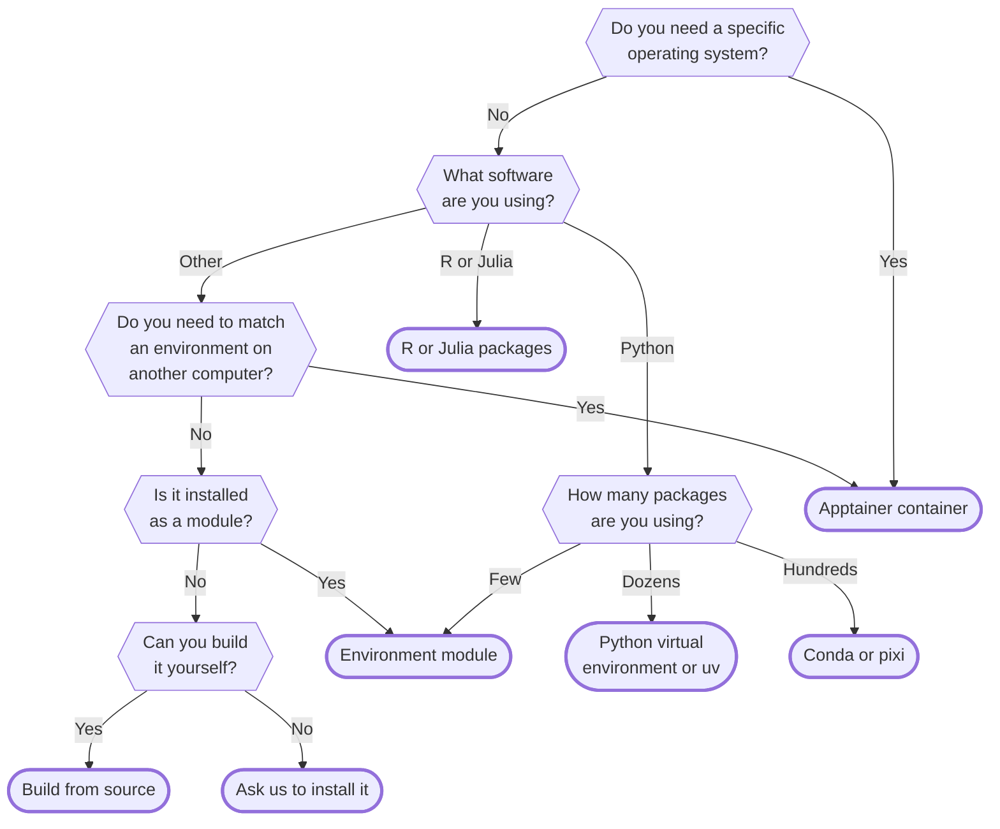

!!! prerequisite
    If you are new to modules, start with the [Environment & Modules](../Tutorials/Introduction_To_HPC/Environment_And_Modules.md) lesson.

There are several ways to set up the software for your research on Mahuika.
They differ in how much control you have, how well the software is optimised for the cluster,
and how easily you, or someone else, can recreate the same environment later.
This page helps you choose one, and record it so your results can be reproduced.







## Comparison

| Method | Good for | On Mahuika | Portable |
| - | - | - | - |
| [Environment module](#environment-modules) | Software REANNZ already installs | Yes | No |
| [Python virtual environment](#virtual-environments) | Adding Python packages to the Python module | Partly, with the Python module | Mostly, with `requirements.txt` |
| [uv](#uv) | New Python projects, and sharing them | Partly, with the Python module | Yes, with `uv.lock` |
| [Conda or Mamba](#conda-and-mamba) | Conda packages, and software with non-Python dependencies | No | Mostly, on the same operating system |
| [pixi](#pixi) | Conda packages, with a lock file | No | Yes, with `pixi.lock` |
| [Apptainer container](#apptainer-containers) | Another operating system, Docker images, and exact copies | Usually not | Yes, copy the image |
| [Build from source](#build-from-source) | Software not available any other way | Yes | No, build it again |

## Environment modules

REANNZ installs and maintains software on the cluster as modules.
They are built and optimised for the cluster's hardware, and need no setup.
Search for a module with `module spider`, or browse [Supported Applications](Available_Applications/index.md).

```sh
module spider Python
```

Load modules with their full version, not just their name.
The default version changes when a newer one is installed, so `module load Python` may give you a different version later.

```sh
module load Python/{{ applications.Python.default }}
```

See [Software Version Management](Software_Version_Management.md) for how versions and compiler toolchains work.

A module can't be copied to another computer. To get the same environment elsewhere, use one of the other methods on this page.
If the software or version you need isn't installed, we can install it: see [Software Installation Request](Software_Installation_Request.md).

## Python packages

The Python module includes many common packages for computational work, such as NumPy, SciPy and Matplotlib.
If it has everything you need, use it directly. To add packages, use a virtual environment or uv, described below.

Only use `pip install --user` if you are not using Python as part of a reproducible workflow. It installs packages in your home directory, where every project shares them and they can conflict.

### Virtual environments

A Python virtual environment is a directory holding the packages for one project, on top of a Python module.
You create one with the `venv` module that comes with Python, and install packages into it with `pip`.
Create it in your project directory, so it doesn't fill your home directory and your collaborators can use it,
and load the same Python module whenever you use it.
See [Installing packages in a Python virtual environment](Available_Applications/Python.md#installing-packages-in-a-python-virtual-environment).

### uv

[uv](Available_Applications/uv.md) is a newer tool that does the same job as `venv` and `pip`, much faster.
It also writes a lock file, `uv.lock`, listing the exact version of every package,
so `uv sync` can recreate the same environment on Mahuika or any other computer.
This makes uv a good choice for a new Python project, or one you share with others.
The [uv](Available_Applications/uv.md#caching) page explains how to keep its cache out of your home directory.

## Conda environments

Conda installs packages from channels such as conda-forge.
Unlike `pip`, it can install compiled libraries and software written in other languages, so many research tools are distributed as conda packages.
Use Conda when your software is a conda package, or your Python project needs many packages with complex dependencies.
You can manage conda packages with Conda and Mamba, or with pixi.

Conda packages have some drawbacks on the cluster:

- They are generic builds, not optimised for the cluster's hardware, and they aren't curated by REANNZ.
- An environment can contain a large number of files, which count towards your project's
  [quota on the number of files](../Storage/Filesystems_and_Quotas.md#nesiproject).

### Conda and Mamba

`conda` and `mamba` are provided by the [Miniforge3](Available_Applications/Miniforge3.md) module.
`mamba` works like `conda`, but resolves dependencies faster.
Follow the setup on the Miniforge3 page. In particular, don't run `conda init`,
and create environments in your project directory with `--prefix`, so they don't fill your home directory.

### pixi

A newer tool, [pixi](Available_Applications/pixi.md), installs the same conda packages, as well as packages from PyPI.
Like uv, it keeps a lock file, `pixi.lock`, next to the project's `pixi.toml`,
so `pixi install` recreates the exact environment on another computer.
Each project gets its own environment, in a `.pixi` directory inside the project.
The [pixi](Available_Applications/pixi.md#set-the-cache-directory) page explains how to keep its cache out of your home directory.

## R and Julia packages

The R and Julia modules include many packages, and you can install more into a library in your project directory,
where your collaborators can use the same versions.
See [installing R packages](Available_Applications/R.md#dealing-with-packages) and
[installing Julia packages](Available_Applications/Julia.md#installing-julia-packages).

To record exact package versions, use the [`renv`](https://rstudio.github.io/renv/) package for R,
or a Julia [project environment](https://pkgdocs.julialang.org/v1/environments/), whose `Manifest.toml` lists the version of every package.

For other languages, see [Packages for Existing Module](Installing_Applications_Yourself.md#packages-for-existing-module).

## Apptainer containers

A container holds software together with its operating system and every library it needs, in a single image file.
Mahuika runs containers with [Apptainer](Containers/Apptainer.md), which can also pull and run Docker images.

Use a container when:

- the software needs a different operating system, or newer system libraries, than the cluster has,
- the developers distribute it as a Docker or Apptainer image,
- you need exactly the same environment on Mahuika and another computer.

An image is a single file, so it is easy to copy, archive and share, and it doesn't add thousands of files to your quota.
Building your own image takes more work than the other methods, and MPI and GPU software need extra setup:
see [MPI in Apptainer](Containers/Apptainer.md#mpi) and [NVIDIA GPU Containers](Containers/NVIDIA_GPU_Containers.md).

## Build from source

If none of these methods has your software, you can compile it yourself with the cluster's compilers and libraries.
See [Installing Applications Yourself](Installing_Applications_Yourself.md) for the usual steps.

Software you build yourself is yours to maintain. Install it in your project directory,
and keep a note of the modules you built it with, as you will need the same modules loaded to run it.

We can also install software for you, or help you install it.
See [Software Installation Request](Software_Installation_Request.md) for what to tell us.

## Record your environment

Whichever method you use, save the files that describe your environment with your code,
ideally in version control such as [Git](../Getting_Started/Cheat_Sheets/Git-Reference_Sheet.md).
With them, you, your collaborators or a reviewer can recreate the environment later.
This is part of making research software reusable, as described in
[Introducing the FAIR Principles for research software](https://www.nature.com/articles/s41597-022-01710-x).

| Method | What to save | How to recreate it |
| - | - | - |
| Environment modules | The `module load` lines, with full versions, in your batch script | Load the same modules |
| Python virtual environment | `requirements.txt`, from `pip freeze > requirements.txt` | `pip install -r requirements.txt` in a new virtual environment |
| uv | `pyproject.toml` and `uv.lock` | `uv sync` |
| Conda | `environment.yml`, from `conda env export > environment.yml` | `conda env create --file environment.yml --prefix /nesi/project/<my_project>/my_conda_env` |
| pixi | `pixi.toml` and `pixi.lock` | `pixi install` |
| Apptainer | The definition file (`.def`), and the image (`.sif`) for an exact copy | `apptainer build`, or copy the image |
| Built from source | The source version, the modules you loaded, and your build commands | Repeat the build |

## Environments in JupyterLab

You can use a module, Python virtual environment, Conda environment or container in JupyterLab on Mahuika OnDemand
by adding it as a kernel. The `nesi-add-kernel` tool does most of the setup.
See [Python and R Kernels in JupyterLab](../Interactive_Computing/OnDemand/Apps/JupyterLab/python_and_r_kernels_in_JupyterLab.md)
and [Containers as Kernels in JupyterLab](../Interactive_Computing/OnDemand/Apps/JupyterLab/containers_as_kernels_in_JupyterLab.md).
