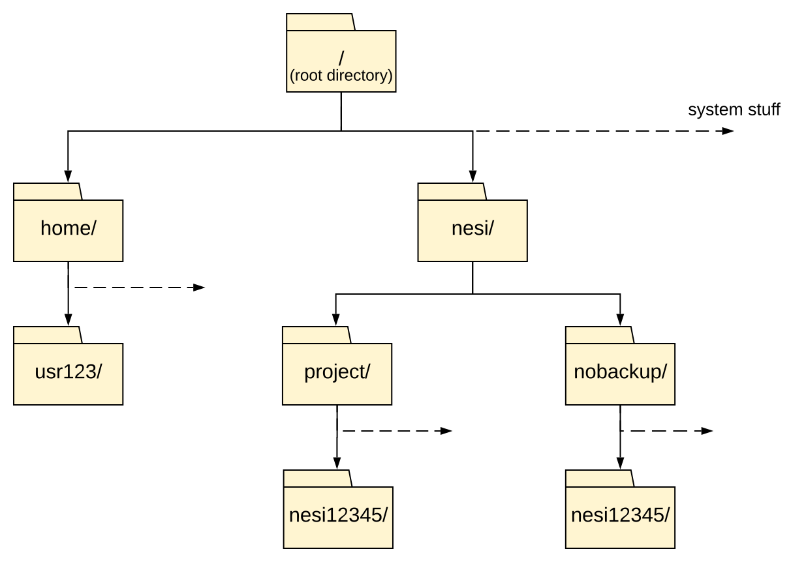

!!! time "50 Minutes"

!!! objectives
    - Create, edit, manipulate and remove files from the command line.
    - Translate an absolute path into a relative path and vice versa.
    - Use options and arguments to change the behaviour of a shell command.
    - Demonstrate the use of tab completion and explain its advantages.
    - Use wildcards to work with several files at once.
    - Check how much storage you are using.

!!! info "The Unix Shell"
    This episode will be a quick introduction to the Unix shell, only the bare minimum required to use the cluster.
    The Software Carpentry '[Unix Shell](https://swcarpentry.github.io/shell-novice/)' lesson covers the subject in more depth, we recommend you check it out.

## The command line

The *shell* is the program that reads the commands you type and runs them.
On Mahuika the shell is called Bash.

When the shell is ready for a command, it shows a *prompt*, something like this:

```out
[username@login03 ~]$
```

Type a command after the prompt and press <kbd>Enter</kbd> to run it.
Many commands print nothing when they work, so no output usually means success.
If something goes wrong, the command prints an error message instead.

!!! tip "Getting unstuck"
    If a command seems stuck, or the prompt has changed to `>`, press <kbd>Ctrl</kbd>+<kbd>C</kbd>.
    This cancels the command and gives you your prompt back.

## Current working directory

The part of the operating system responsible for managing files and directories is called the **filesystem**.
It organises our data into files, which hold information, and directories (also called 'folders'), which hold files or other directories.

Understanding how to navigate the filesystem using command line is essential for using an HPC.

The Mahuika filesystem looks something like this:



Directories are like *places* — at any time while we are using the shell, we are in exactly one place called our **current working directory**.
Commands mostly read and write files in the current working directory, i.e. 'here', so knowing where you are before running a command is important.

First, let's find out where we are by running the command `pwd`, short for 'print working directory'.

```sh
pwd
```

```out
/home/username
```

The output we see is what is known as a 'path'.
The path can be thought of as a series of directions given to navigate the filesystem.

At the top is the **root directory** that holds all the files in a filesystem.

We refer to it using a slash character, `/`, on its own.
This is what the leading slash in `/home/username` is referring to, it is telling us our path starts at the root directory.

Next is `home`, which is inside the root directory.
We know `home` is a directory because the path continues after it.
Finally, inside `home` is the directory with your username: your *home directory*.

!!! info "Slashes"
    Notice that there are two meanings for the `/` character.
    When it appears at the front of a file or directory name,
    it refers to the root directory. When it appears *inside* a path,
    it's just a separator.

As you may now see, using a bash shell is strongly dependent on the idea that your files are organised in a hierarchical filesystem.
Organising things hierarchically in this way helps us keep track of our work: it's possible to put hundreds of files in our home directory, just as it's possible to pile hundreds of printed papers on our desk, but it's a self-defeating strategy.

## Listing contents of directories

To list the contents of a directory, we use the command `ls` (short for 'list') followed by the path to the directory whose contents we want listed.

??? note "Solo learners"
    This tutorial series was originally written for a live workshop, where every attendee
    was added to a shared training project (`nesi99991`) with a working directory already
    created for them, already containing the files used in later exercises.

    If you're working through this on your own, you won't have access to `nesi99991`.
    Everywhere these lessons use `{{extra.working_directory[0]}}/{{extra.working_directory[1]}}`
    (including the `--account` line in later Slurm scripts), substitute your own project's
    code.

    For the next exercise you will need to run:

    ```sh
    mkdir -p {{extra.working_directory[0]}}/{{extra.working_directory[1]}}
    ```

    When you have to download the additional files, they will be called out in blocks like this.

We will now list the contents of the directory we will be working from.
We can use the following command to do this:

```sh
ls {{extra.working_directory[0]}}
```

```out
{{extra.working_directory[1]}}
```

You should see a directory called `{{extra.working_directory[1]}}`, and possibly several other directories.
For the purposes of this tutorial you will be working within `{{extra.working_directory[0]}}/{{extra.working_directory[1]}}`.

!!! tip "Command History"
    You can cycle through your previous commands with the <kbd>↑</kbd> and <kbd>↓</kbd> keys.  
    A convenient way to repeat your last command is to type <kbd>↑</kbd> then <kbd>enter</kbd>.

This quiz uses a file tree from a different computer.
On macOS, home directories are in `/Users` rather than `/home`.

<quiz>
<p class=admonition-title>Path Resolution</p>

Given the below file tree.


What command would you type to get the following output?

```out
original pnas_final pnas_sub
```

- [ ] `ls pwd`
> `pwd` is not the name of a directory.
- [] `ls backup`
> `ls backup` depends on your current directory. This would be correct only if your current working directory is `Users`.
- [X] `ls /Users/backup`
- [ ] `ls /backup`
> There is no such directory.

</quiz>

## Moving about

Currently we are still in our home directory. We want to move into the `{{extra.working_directory[1]}}` directory we just listed.

The command to change directory is `cd` followed by the path to the directory we want to move to.

The `cd` command is akin to double clicking a folder in a graphical interface.

We will use the following command:

```sh
cd {{extra.working_directory[0]}}/{{extra.working_directory[1]}}
```

You will notice that `cd` doesn't print anything.
As mentioned earlier, that means it worked.
We can check we are in the right place by running `pwd`.

```sh
pwd
```

```out
{{extra.working_directory[0]}}/{{extra.working_directory[1]}}
```

## Creating directories

<!-- NOTE: This bit uses relative paths even though the concept hasn't been introduced yet. -->

As previously mentioned, it is generally useful to organise your work in a hierarchical file structure to make managing and finding files easier.
It is especially important when working within a shared directory with colleagues, such as a project, to minimise the chance of accidentally affecting your colleagues' work.
So for this tutorial you will each make a directory using the `mkdir` command within your project's nobackup directory for you to personally work from.

```sh
mkdir $USER
```

`$USER` is a variable that holds your username, so this makes a directory named after you.
Variables are explained in [Environment & Modules](Environment_And_Modules.md#environment).

You should then be able to see your new directory is there using `ls`.

```sh
ls {{extra.working_directory[0]}}/{{extra.working_directory[1]}}
```

```out
birds  {{extra.example_script}}  username  usr123
```

!!! note "Your Mileage May Vary"
    There may already be files and subdirectories in your project's nobackup directory if it isn't a brand new project.

!!! tip "Naming files and directories"
    Names are case sensitive: `Birds` and `birds` are different directories.

    Avoid spaces in names. The shell uses spaces to separate arguments,
    so `mkdir my data` makes two directories, `my` and `data`.
    Use `-` or `_` instead, as in `my_data`.

## General syntax of a shell command

We are now going to use `ls` again but with a twist, this time we will also use what are known as **options**, **flags** or **switches**.
These options modify the way that the command works, for this example we will add the flag `-l` for "long listing format".

```sh
ls -l {{extra.working_directory[0]}}/{{extra.working_directory[1]}}
```

```out
drwxr-s---+ 1 usr9999  nesi99991    0 Jul  2 09:44 birds
-rwxr-x---+ 1 usr9999  nesi99991 1755 Jul  2 09:44 {{ extra.example_script }}
drwxrws---+ 1 username nesi99991    0 Jul  3 12:00 username
drwxrws---+ 1 usr123   nesi99991    0 Jul  3 11:50 usr123
```

We can see that the `-l` option has modified the command and now our output has listed all the files with details, which can make finding a specific file easier.
It also includes information about the file size, time of its last modification, and permission and ownership information.
The first character of each line shows what kind of entry it is: `d` for a directory, and `-` for a file.

Most Unix commands follow this basic structure.

![A diagram showing the structure of a Unix command. The first section is the prompt and in the example reads `[yourUsername@mahuika] ~`. The second section is the command and the example reads `ls`. The third section is the option which is `-l` in the example. The last section is the argument which is `/nesi/project/project_nesi99991` in the example.](../../assets/images/Unix_Command_Struc.svg)

The **prompt** tells us that the terminal is accepting inputs, prompts can be customised to show all sorts of info.

The **command**, what are we trying to do.

**Options** will modify the behaviour of the command, multiple options can be specified.
Options will either start with a single dash (`-`) or two dashes (`--`).
Often options will have a short and long format e.g. `-a` and `--all`.

**Arguments** tell the command what to operate on (usually files and directories).

Each part is separated by spaces: if you omit the space
between `ls` and `-l` the shell will look for a command called `ls-l`, which
doesn't exist. Also, capitalisation can be important.
For example, `ls -s` will display the size of files and directories alongside the names,
while `ls -S` will sort the files and directories by size.

### Hidden files

Another useful option for `ls` is the `-a` option, let's try using this option together with the `-l` option:

```sh
ls -la
```

```out
drwxrws---+ 1 usr9999  nesi99991    0 Jul  3 11:20 .
drwxrws---+ 1 root     nesi99991    0 Sep 17 10:07 ..
drwxr-s---+ 1 usr9999  nesi99991    0 Jul  2 09:44 birds
-rwxr-x---+ 1 usr9999  nesi99991 1755 Jul  2 09:44 {{extra.example_script}}
drwxrws---+ 1 username nesi99991    0 Jul  3 12:00 username
drwxrws---+ 1 usr123   nesi99991    0 Jul  3 11:50 usr123
```

Single letter options don't usually need to be separate. In this case `ls -la` is performing the same function as if we had typed `ls -l -a`.

You might notice that we now have two extra lines for directories `.` and `..`. These are hidden directories which the `-a` option has been used to reveal, you can make any file or directory hidden by beginning their filenames with a `.`.

These two specific hidden directories are special as they will exist hidden inside every directory, with the `.` hidden directory representing your current directory and the `..` hidden directory representing the **parent** directory above your current directory.

<quiz>
<p class=admonition-title>More <code>ls</code> flags.</p>

You can also use two options at the same time. What does the command `ls` do when used
with the `-l` option? What about if you use both the `-l` and the `-h` option (`ls -lh`)?

- [X] Long-List.
> `-l` option makes `ls` use a long listing format, showing not only the file/directory names but also additional information,
> such as the file size and the time of its last modification.
- [X] Human readable.
> `-h` means 'human readable', i.e. displaying something like `5.3K` instead of `5369`.
- [] Sort by file size.
> `-S` will sort by file size.
- [] Show Help page.
</quiz>

<quiz>
<p class=admonition-title>Listing in Reverse Chronological Order</p>

By default, `ls` lists the contents of a directory in alphabetical
order by name. The command `ls -t` lists items by time of last
change instead of alphabetically. The command `ls -r` lists the
contents of a directory in reverse order.

Which commands list files in reverse chronological order (oldest first, so the newest file is listed last)?
Hint: You may need to use the `-l` flag to see the last changed dates.

- [x] `ls -lrt`
> The most recently changed file is listed last when using `-rt`. This can be useful for finding your most recent edits or checking to see if a new output file was written.
- [x] `ls -ltr`
> The order of single letter options doesn't matter, so this is the same as `ls -lrt`.
- [ ] `ls -lt`
> `-t` on its own lists the newest file first.
- [ ] `ls -lr`
> `-r` on its own reverses the alphabetical order.

</quiz>

## Getting help

If you try to use an option (flag) that is not supported, `ls` and other commands
will usually print an error message similar to:

```sh
ls -j
```

```out
ls: invalid option -- 'j'
Try 'ls --help' for more information.
```

Commands will often have many **options**. Most commands have a `--help` flag, as can be seen in the error above. You can also use the manual pages (aka manpages) by using the `man` command. The manual page provides you with all the available options and their use in more detail.

The manual page fills your terminal until you close it.
To **quit** the `man` pages and get your prompt back, press <kbd>Q</kbd>.

For example, for the `ls` command:

```sh
man ls
```

```out
LS(1)                            User Commands                           LS(1)

NAME
       ls - list directory contents

SYNOPSIS
       ls [OPTION]... [FILE]...

DESCRIPTION
       List  information  about  the FILEs (the current directory by default).
       Sort entries alphabetically if none of -cftuvSUX nor --sort  is  speci-
       fied.

       Mandatory  arguments  to  long  options are mandatory for short options
       too.

       -a, --all
              do not ignore entries starting with .

       -A, --almost-all
              do not list implied . and ..

       --author
              with -l, print the author of each file
...
```

To navigate through the `man` pages,
you may use <kbd>↑</kbd> and <kbd>↓</kbd> to move line-by-line,
or try <kbd>B</kbd> and <kbd>spacebar</kbd> to skip up and down by a full page.
To search for a character or word in the `man` pages,
use <kbd>/</kbd> followed by the character or word you are searching for.
Sometimes a search will result in multiple hits. If so, you can move between hits using <kbd>N</kbd> (for moving forward) and <kbd>Shift</kbd>+<kbd>N</kbd> (for moving backward).

!!! info "Manual pages on the web"
    Of course, there is a third way to access help for commands:
    searching the internet via your web browser.
    When using internet search, including the phrase `unix man page` in your search
    query will help to find relevant results.
    GNU provides links to its
    [manuals](https://www.gnu.org/manual/manual.html) including the
    [core GNU utilities](https://www.gnu.org/software/coreutils/manual/coreutils.html),
    which covers many commands introduced within this lesson.

## Relative paths

You may have noticed that when we ran `ls -la`, we did not give it a directory path.
Until now, when specifying directory names, or even a directory path (as above),
we have been using what are known as **absolute paths**, which work no matter where you are currently located on the machine
since it specifies the full path from the top level root directory.

An **absolute path** always starts at the root directory, which is indicated by a
leading slash. The leading `/` tells the computer to follow the path from
the root of the filesystem, so it always refers to exactly one directory,
no matter where we are when we run the command.

Any path without a leading `/` is a **relative path**.

When you use a relative path with a command
like `ls` or `cd`, it tries to find that location starting from where we are,
rather than from the root of the filesystem.

When we ran `ls -la` without a path, it listed the current directory
(implicitly using the `.` hidden directory).

We will now navigate to the parent directory, the simplest way to do this is to use the relative path `..`

```sh
cd ..
```

We should now be back in `{{extra.working_directory[0]}}`.

```sh
pwd
```

```out
{{extra.working_directory[0]}}
```

### When a path is wrong

The most common error you will see is `No such file or directory`.
Let's make one on purpose, by getting the capitalisation of the next directory wrong:


```sh
cd {{ wrong_dir }}
```

```out
-bash: cd: {{ wrong_dir }}: No such file or directory
```

This error means the shell could not find that path, starting from where you are.
When you see it, check the spelling and capitalisation, and run `pwd` and `ls` to check where you are and what is there.

### Shortcuts

Now let's move into your own directory with a relative path.
From here, it is inside `{{extra.working_directory[1]}}`:

```sh
cd {{extra.working_directory[1]}}/$USER
pwd
```

```out
{{extra.working_directory[0]}}/{{extra.working_directory[1]}}/username
```

`cd` on its own, with no path, takes you to your home directory:

```sh
cd
pwd
```

```out
/home/username
```

A tilde (`~`) at the start of a path is shorthand for your home directory, so `cd ~` does the same thing,
and `~/data` means `/home/username/data`.

`cd -` takes you back to the directory you were in before, and prints its path:

```sh
cd -
```

```out
{{extra.working_directory[0]}}/{{extra.working_directory[1]}}/username
```

The difference between `cd ..` and `cd -` is that the former brings you *up*, while the latter brings you *back*.

<quiz>
<p class=admonition-title>Absolute vs Relative Paths</p>

Starting from `/home/amanda/data`, which of the following commands could Amanda use to navigate to her home directory (`/home/amanda`)?

- [] `cd .`
> `.` stands for the current directory.
- [] `cd /`
> `/` stands for the root directory.
- [] `cd home/amanda`
> Amanda's home directory is `/home/amanda` (note the leading slash).
- [] `cd ../..`
> `../..` will take you up two levels, i.e. ends in `/home`.
- [X] `cd ~`
- [] `cd home`
> `cd home` would navigate into a directory `home` in the current directory if it exists.
- [X] `cd ~/data/..`
> `cd ~/data/..` is correct, but more complex than needed.
- [X] `cd`
- [X] `cd ..`

</quiz>

<quiz>
<p class=admonition-title>Relative Path Resolution</p>

Using the filesystem diagram below, if `pwd` displays `/Users/thing`,
what will `ls ../backup` display?


- [] `../backup: No such file or directory`
> There *is* a directory `backup` in `/Users`.
- [] `2012-12-01 2013-01-08 2013-01-27`
> Is the content of `Users/thing/backup`, but with `..`, we asked for one level further up.
- [X] `original pnas_final pnas_sub`
> `../backup/` refers to `/Users/backup/`.

</quiz>

## Tab completion

Sometimes file paths and filenames can be long, making typing out the path tedious.
One trick you can use to save yourself time is to use something called **tab completion**.
If you start typing a name and there is only one possible match,
pressing <kbd>Tab</kbd> (the tab key on your keyboard) completes it for you.

!!! note "Solo Learners"
    If the `birds` directory isn't present in `{{ config.extra.working_directory|join('/') }}` (you are not in an organised workshop), fetch your own copy:

    ```sh
    ASSETS=https://raw.githubusercontent.com/nesi/support-docs/main/docs/assets
    mkdir -p {{ config.extra.working_directory|join('/') }}/birds
    cd {{ config.extra.working_directory|join('/') }}/birds
    wget ${ASSETS}/workshop/birds/{kaka.txt,kea.txt}
    wget ${ASSETS}/workshop/birds/{kakapo.jpeg,kiwi.jpeg,pukeko.jpeg}
    cd -
    ```

Next to your own directory is a directory called `birds`.
From your own directory, type the following, but don't press <kbd>Enter</kbd> yet:

```sh
cd ../bi
```

Now press <kbd>Tab</kbd>. Since `birds` is the only match, the shell completes the name:

```sh
cd ../birds/
```

Press <kbd>Enter</kbd> to run the command, and check where you are:

```sh
pwd
```

```out
{{ config.extra.working_directory|join('/') }}/birds
```

If more than one name matches, pressing <kbd>Tab</kbd> once does nothing, and pressing it twice lists the matches.
Type the following, and press <kbd>Tab</kbd> twice:

```sh
ls k
```

```out
kakapo.jpeg  kaka.txt     kea.txt      kiwi.jpeg
```

Type more letters until only one name matches (for example `ls kakap`), then press <kbd>Tab</kbd> again to complete it.

!!! tip "Lots of matches"
    If there are a lot of matches, the shell asks before listing them all.
    For example, there are over a thousand projects in `/nesi/nobackup`,
    so pressing <kbd>Tab</kbd> twice after `cd /nesi/nobackup/` shows:

    ```out
    Display all 1331 possibilities? (y or n)
    ```

    Press <kbd>N</kbd> to skip the list.

!!! tip "Clearing your terminal"
    If your screen gets too cluttered, you can clear your terminal using the
    `clear` command. You can still access previous commands using <kbd>↑</kbd>
    and <kbd>↓</kbd> to move line-by-line, or by scrolling in your terminal.

## Globbing

One of the most powerful features of bash is *filename expansion*, otherwise known as *globbing*.
This allows you to use *patterns* to match a filename (or multiple files),
which will then be operated on as if you had typed out all of the matches.

`*` is a **wildcard**, which matches zero or more characters.

You should still be in the `birds` directory from the last section.
List its contents:

```sh
ls
```

```out
kakapo.jpeg  kaka.txt  kea.txt  kiwi.jpeg  pukeko.jpeg
```

In this example there aren't many files, but it is easy to imagine a situation where you have hundreds or thousands of files you need to filter through, and globbing is the perfect tool for this. Using the wildcard character the command

```sh
ls ka*
```

Will return:

```out
kakapo.jpeg  kaka.txt
```

Since the pattern `ka*` will match `kakapo.jpeg` and `kaka.txt` as these both start with `ka`. While the command:

```sh
ls *.jpeg
```

Will return:

```out
kakapo.jpeg  kiwi.jpeg  pukeko.jpeg
```

As `*.jpeg` will match  `kakapo.jpeg`, `kiwi.jpeg` and `pukeko.jpeg` as they all end in `.jpeg`.
You can use multiple wildcards as well with the command:

```sh
ls k*a.*
```

Returning:

```out
kaka.txt  kea.txt
```

As `k*a.*` will match just `kaka.txt` and `kea.txt`.

`?` is also a wildcard, but it matches exactly one character. So the command:

```sh
ls ????.*
```

Would return:

```out
kaka.txt  kiwi.jpeg
```

As `kaka.txt` and `kiwi.jpeg` are the only files which have four characters, followed by a `.` then any number and combination of characters.

When the shell sees a wildcard, it expands the wildcard to create a
list of matching filenames *before* running the command that was
asked for. As an exception, if a wildcard expression does not match
any file, Bash will pass the expression as an argument to the command
as it is.
However, generally commands like `ls` see the lists of
filenames matching these expressions, but not the wildcards
themselves. It is the shell, not the other programs, that deals with
expanding wildcards.

<quiz>
<p class=admonition-title>Matching files with a Pattern</p>

Running `ls` in a directory gives the output `cubane.pdb  ethane.pdb  methane.pdb  octane.pdb  pentane.pdb  propane.pdb`

Which `ls` command(s) will produce this output?

`ethane.pdb   methane.pdb`

- [ ] `ls *t*ane.pdb`
> This shows all files whose names contain zero or more characters (`*`) followed by the letter `t`, then zero or more characters (`*`) followed by `ane.pdb`. This gives `ethane.pdb  methane.pdb  octane.pdb  pentane.pdb`
- [ ] `ls *t?ne.*`
> This shows all files whose names start with zero or more characters (`*`) followed by the letter `t`, then a single character (`?`), then `ne.` followed by zero or more characters (`*`). This will give us `octane.pdb` and `pentane.pdb` but doesn't match anything which ends in `thane.pdb`.
- [X] `ls *t??ne.pdb`
> This is the solution. It fixes the problems of option 2 by matching two characters (`??`) between `t` and `ne`.
- [ ] `ls ethane.*`
> This only shows files starting with `ethane.`.

</quiz>

<!-- TODO: include in terminal excersise (delete slurm files later on maybe?) -->

## Create a text file

Let's move back into the directory you created earlier, using a relative path:

```sh
cd ../$USER
pwd
```

```out
{{ config.extra.working_directory|join('/') }}/username
```

Now let's create a file. To do this we will use a text editor called Nano.
Nano is controlled with the <kbd>Ctrl</kbd> key, so first a word on how that is written.

!!! tip "Control, Ctrl, or ^ Key"
    The Control key is also called the 'Ctrl' key. There are various ways
    in which using the Control key may be described. For example, you may
    see an instruction to press the <kbd>Control</kbd> key and, while holding it down,
    press the <kbd>X</kbd> key, described as any of:

    - `Control-X`
    - `Control+X`
    - `Ctrl-X`
    - `Ctrl+X`
    - `^X`
    - `C-x`

    In nano, along the bottom of the screen you'll see `^G Get Help ^O WriteOut`.
    This means that you can use `Control-G` to get help and `Control-O` to save your
    file.

    On a Mac, use the <kbd>Control</kbd> key, not <kbd>Command</kbd>.

### Using nano

Open Nano to create a file called `draft.txt`:

```sh
nano draft.txt
```

Let's type in a few lines of text.
Once we're happy with our text, we can press <kbd>Ctrl</kbd>+<kbd>O</kbd>
(press the <kbd>Ctrl</kbd> or <kbd>Control</kbd> key and, while
holding it down, press the <kbd>O</kbd> key) to write our data to disk
(we'll be asked what file we want to save this to:
press <kbd>Return</kbd> to accept the suggested default of `draft.txt`).


Once our file is saved, we can use <kbd>Ctrl</kbd>+<kbd>X</kbd> to quit the editor and
return to the shell.

If you press <kbd>Ctrl</kbd>+<kbd>X</kbd> before saving, nano asks whether to save the modified buffer (your changes).
Press <kbd>Y</kbd>, then <kbd>Enter</kbd> to keep the name `draft.txt`.

!!! warning "Terminals in a web browser"
    If you are using a terminal in a web browser, such as in OnDemand, the browser may catch some shortcuts before nano does.
    For example, <kbd>Ctrl</kbd>+<kbd>W</kbd> is nano's search, but in most browsers it closes the tab.

`nano` doesn't leave any output on the screen after it exits,
but `ls` now shows that we have created a file called `draft.txt`:

```sh
ls
```

```out
draft.txt
```

!!! note "Which Editor?"
    When we say, '`nano` is a text editor' we really do mean 'text': it can
    only work with plain character data, not tables, images, or any other
    human-friendly media. We use it in examples because it is one of the
    least complex text editors. However, because of this trait, it may
    not be powerful enough or flexible enough for the work you need to do
    after this tutorial. On Unix systems (such as Linux and macOS),
    many programmers use [Emacs](https://www.gnu.org/software/emacs/) or
    [Vim](https://www.vim.org/) (both of which require more time to learn).

    No matter what editor you use, you will need to know where it searches
    for and saves files. If you start it from the shell, it will (probably)
    use your current working directory as its default location.

## Copying files and directories

In a future lesson, we will be running the R script `{{ extra.working_directory|join('/') }}/{{extra.example_script}}`, but as we can't all work on the same file at once you will need to take your own copy.
This can be done with the copy command `cp`. It needs at least two arguments: the file (or directory) you want to copy, and the directory (or file) where you want the copy to be created.
We will be copying the file into the directory we made previously. As this should be your current directory, the second argument can be a simple `.` (the current directory).

!!! tip "Solo Learners"
    If `{{extra.example_script}}` isn't present at that path (you are not in an organised workshop), fetch your own copy directly instead of using `cp`:

    ```sh
    ASSETS=https://raw.githubusercontent.com/nesi/support-docs/main/docs/assets
    wget ${ASSETS}/workshop/{{extra.example_script}}
    ```

```sh
cp {{ extra.working_directory|join('/') }}/{{extra.example_script}} .
```

We can check that it did the right thing using `ls`

```sh
ls
```

```out
draft.txt  {{extra.example_script}}
```

## Other file operations

`cat` prints the contents of a file to the screen.
Its name comes from 'concatenate', as it can also join several files together.

```sh
cat draft.txt
```

It prints the text you typed in nano, for example:

```out
It's not "publish or perish" any more,
it's "share and thrive".
```

`head` and `tail` print the first or last lines of a file.
By default they print 10 lines, but you can set how many with the `-n` option:

```sh
head -n 5 {{extra.example_script}}
```

```out
#!/usr/bin/env Rscript

# Function for shared memory execution
doTask <- function(size_x, size_y, seed, print_progress) {
    suppressPackageStartupMessages(library(doParallel))
```

### Copy, move and remove

`cp` can also copy a file to a new name in the same directory:

```sh
cp draft.txt notes.txt
ls
```

```out
draft.txt  notes.txt  {{extra.example_script}}
```

`mv` moves a file. It takes source argument(s) and a destination argument, like `cp`.
`mv` is also used to rename a file, as far as the computer is concerned *moving and renaming a file are the same operation*:

```sh
mv notes.txt old_notes.txt
ls
```

```out
draft.txt  old_notes.txt  {{extra.example_script}}
```

`rm` removes a file, and only needs one argument:

```sh
rm old_notes.txt
ls
```

```out
draft.txt  {{extra.example_script}}
```

!!! warning "There is no undo"
    `rm` deletes files straight away: there is no recycle bin.
    `cp` and `mv` also replace an existing file with the same name, without asking.
    If you delete or overwrite something by mistake, you may be able to recover an older copy from a
    [snapshot](../../Storage/Data_Recovery.md).

In order to `cp` a directory (and all its contents) the `-r` for [recursive](https://en.wikipedia.org/wiki/Recursion) option must be used.
The same is true when deleting directories with `rm`.

<table>
  <tr>
    <th>command</th>
    <th>name</th>
    <th>usage</th>
  </tr>
  <tr>
    <td rowspan=2><code>cp</code></td>
    <td rowspan=2>copy</td>
    <td><code>cp file1 file2</code></td>
  </tr>
  <tr>
    <td><code>cp -r directory1/ directory2/</code></td>
  </tr>
  <tr>
    <td rowspan=2><code>mv</code></td>
    <td rowspan=2>move</td>
    <td><code>mv file1 file2</code></td>
  </tr>
  <tr>
    <td><code>mv directory1/ directory2/</code></td>
  </tr>
    <tr>
    <td rowspan=2><code>rm</code></td>
    <td rowspan=2>remove</td>
    <td><code>rm file1 file2</code></td>
  </tr>
  <tr>
    <td><code>rm -r directory1/ directory2/</code></td>
  </tr>
</table>

For `mv` and `cp` if the destination path (final argument) is an existing directory the file will be placed inside that directory with the same name as the source.

!!! question "Moving vs Copying"
    Why must the 'recursive' flag `-r` be used with the `cp` or `rm` commands on a directory, but `mv` *does not* require it?

??? note "Solution"
    We mentioned previously that as far as the computer is concerned, *renaming* is the same operation as *moving*.
    Contrary to what the command's name implies, moving a file within the same filesystem is actually renaming it.
    The data on the disk stays in the same place,
    only the label applied to that data is changed.
    To copy a directory, each *individual file* inside that directory must be read, and then written to the copy destination.
    To delete a directory, each *individual file* in the directory must be marked for deletion,
    however when moving a directory the files inside the directory are not interacted with,
    only the parent directory is "renamed" to a different place.

    This is also why `mv` is faster than `cp`, as no reading of the files is required.
    The exception is moving between two different filesystems: then `mv` has to copy each file and delete the original.

## Where to keep your data

You have been working in `/nesi/nobackup`, one of three places on Mahuika to keep files.
The directories that are relevant to us are:

<table>
<tbody>
<tr>
<td></td>
<td>Location</td>
<td>Default Storage</td>
<td>Snapshot</td>
</tr>
<tr>
<td><strong>Home</strong> is for user-specific files such as configuration files, environment setup, source code, etc.</td>
<td><code>/home/username</code></td>
<td>20 GB</td>
<td>Daily</td>
</tr>
<tr>
<td><strong>Project</strong> is for persistent project-related data, project-related software, etc.</td>
<td><code>/nesi/project/nesi99991</code></td>
<td>100 GB</td>
<td>Daily</td>
</tr>
<tr>
<td><strong>Nobackup</strong> is a 'scratch space', for data you don't need to keep long term. Old data is periodically deleted from nobackup.</td>
<td><code>/nesi/nobackup/nesi99991</code></td>
<td>10 TB</td>
<td>Weekly</td>
</tr>
</tbody>
</table>

### Snapshots

Mahuika takes [snapshots](../../Storage/Data_Recovery.md) of the `/home` and `/nesi/project` (persistent) filesystems once a day,
and of `/nesi/nobackup` once a week.
So, if you edit or change code or data and then immediately delete it, it likely cannot be recovered.

Protecting critical data from corruption or deletion is primarily your responsibility.
Ensure you have a data management plan and stick to the plan to reduce the chance of data loss.

### Checking your quotas

Also important is managing your storage quota.
To check your quotas, use the `storage_quota` command:

```sh
storage_quota
```

```out
Quota_Location                          AvailableGiB           UsedGiB Use%
project_nesi99991                                800               800   100
nobackup_nesi99991                             30720              4608   15
home_username                                     20                13   65
```

Notice that the project space for this user is full, meaning no more data can be added.
When your space is full you will need to move or remove data.
Also note that most of the nobackup space is unused, so a smart idea would be to move data from `project` to `nobackup` with `mv`.

!!! note
    `storage_quota` uses cached data, updated about every hour, so it will not immediately show changes to storage use.

For more details on our persistent and nobackup storage systems, including data retention and the nobackup auto-delete schedule,
please see our [Filesystems and Quotas](../../Storage/Filesystems_and_Quotas.md) documentation.

!!! keypoints
    - The shell runs the commands you type at the prompt. No output usually means success, and <kbd>Ctrl</kbd>+<kbd>C</kbd> cancels a command.
    - `pwd` shows where you are, `ls` lists what is there, and `cd` moves you somewhere else.
    - An absolute path starts at the root directory (`/`). A relative path starts from where you are.
    - `..` is the directory above the current one, `.` is the current directory, and `~` is your home directory.
    - Most commands take options that begin with a `-`. Use `--help` or `man` to find them, and press <kbd>Q</kbd> to leave `man`.
    - Press <kbd>Tab</kbd> to complete names, and use wildcards (`*` and `?`) to match several files at once.
    - `cp`, `mv` and `rm` copy, move and remove files, and there is no undo.
    - Keep data you are working on in nobackup, and data you need to keep in project.

!!! postrequisite "What Next"
    - [Environment & Modules](Environment_And_Modules.md)
