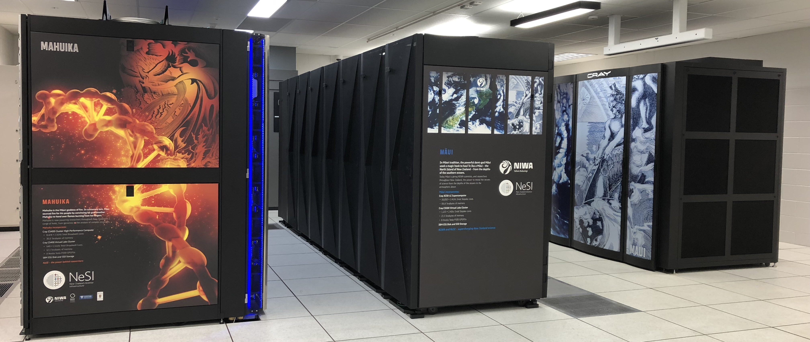
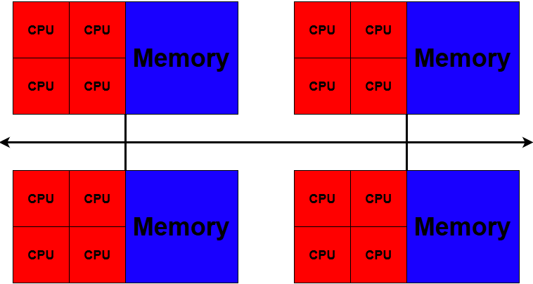

!!! time "15 Minutes"

!!! objectives
    - Understand key terminology.
    - Distinguish between remote and local hardware.
    - Describe key components of cluster architecture.
    - Run your first commands on the cluster.

## What is an HPC system?

The words "cloud", "cluster", and the phrase "high-performance computing" or
"HPC" are used a lot in different contexts and with various related meanings.
So what do they mean? And more importantly, how do we use them in our work?

A *remote* computer is one you have no physical access to, and must connect to over a network (as opposed to a *local* computer).

*Cloud* refers to remote computing resources
that are provisioned to users on demand or as needed.

*HPC*, *High Performance Computer*, *High Performance Computing* or *Supercomputer* are all general terms for a large or powerful computing resource.

*Cluster* is a more specific term describing a type of supercomputer comprised of multiple smaller computers (nodes) working together.
Almost all supercomputers are clusters.

We will generally use 'cluster'.


*The REANNZ High Performance Cluster*

## Access

You will connect to a cluster over the internet either with a web client ([OnDemand](../../Interactive_Computing/OnDemand/OnDemand_Overview.md)) or with [SSH (Secure Shell)](../../Getting_Started/Accessing_the_HPCs/Connecting_to_the_Cluster.md).
Your main interface with the cluster will be using command line.

## Nodes

Individual computers that compose a cluster are typically called *nodes*.
On a cluster, there are different types of nodes for different
types of tasks. The node where you are now will be different depending on
how you accessed the cluster.

If you connected with SSH, you are on a *login node*. (If you connect with Mahuika OnDemand, you will not technically be on a login node, but can be treated as such)
Login nodes are the access point to the cluster.

The real work on a cluster gets done by the *compute nodes*.
Compute nodes come in many shapes and sizes, but generally are dedicated to long
or hard tasks that require a lot of computational resources.

## What's in a node?

A node is similar in makeup to a regular desktop or laptop, composed of *CPUs* (sometimes also called *processors* or *cores*), *memory*
(or *RAM*), and *disk* space. Where your laptop might have 8 CPUs and 16 GB of memory, most Mahuika compute nodes have 128 or 168 cores, and 384 GB or more of memory
(see [Hardware](../../Batch_Computing/Hardware.md)).

- **CPUs** are a computer's tool for running programs and calculations.

- **Memory** is for short-term storage, containing the information currently being operated on by the CPUs.

- **Disk** is for long-term storage, data stored here is permanent, i.e. still there even if the computer has been restarted.
It is common for nodes to connect to a shared, remote disk.



!!! info "Differences Between Nodes"
    Many HPC clusters have a variety of nodes optimised for particular workloads.
    Some nodes may have larger amounts of memory, or specialised resources such as
    Graphical Processing Units (GPUs).

!!! info "Dedicated Transfer Nodes"
    If you want to transfer larger amounts of data to or from the cluster, REANNZ
    offers dedicated transfer nodes using the Globus service.  
    More information on using Globus for large data transfer to and from the cluster can be found on the
    [Globus Transfer Service](../../Data_Transfer/Globus/Globus_Overview.md) page.

<quiz>
Mahuika is...

- [x] A 'High Performance Computer'.
- [x] A 'Cluster'
- [] A 'Cloud'
> Mahuika is not a cloud resource, however [RDC](../../Service_Subscriptions/Research_Developer_Cloud/User_Guides.md) is.
- [x] A 'Remote Server'
> Technically Mahuika is a server, but not the most useful description.
- [] A 'Node'
> Mahuika is composed of many nodes.
- [x] A 'Computer'
- [] A way of being.
</quiz>

## Have a look around

Let's run a few commands to see where we are.
Type each command and press <kbd>Enter</kbd>.
Your numbers will be different from the examples below, especially if you connected with OnDemand,
as they change while people use the cluster.

`hostname` prints the name of the computer you are on:

```sh
hostname
```

```out
login03.hpc.nesi.org.nz
```

If you connected with SSH, the name starts with `login`, so you are on a login node.

!!! tip "Local and remote"
    If you have a terminal open on your own computer, run `hostname` there too.
    You will get a different name: one is your local computer, the other is the remote cluster.

Before running the next two commands, guess how many CPUs and how much memory your laptop has.
Then guess the same for the login node.

`nproc` prints the number of CPUs you can use:

```sh
nproc
```

```out
248
```

`free -h` prints the amount of memory, in human readable units (`-h`).
The `total` column is the memory in the node, here `503Gi`:

```sh
free -h
```

```out
               total        used        free      shared  buff/cache   available
Mem:           503Gi       161Gi       3.5Gi       5.8Gi       352Gi       341Gi
Swap:             0B          0B          0B
```

That is a lot more than a laptop, but you are not the only one using it.
`who` lists the login sessions on this node, and `wc -l` counts them.
The `|` passes the output of `who` to `wc` (more on this in [Environment & Modules](Environment_And_Modules.md)):

```sh
who | wc -l
```

```out
148
```

The login node is shared by everyone logged in to it.
That is why login nodes are for light work, such as editing files and submitting jobs,
and anything that needs a lot of CPU or memory should run on the compute nodes.

`sinfo` shows the compute nodes, grouped into *partitions*.
The `genoa` and `milan` partitions are named after the type of CPU in their nodes:

```sh
sinfo
```

```out
PARTITION AVAIL  TIMELIMIT   NODES(A/I/O/T) NODELIST
genoa        up 21-00:00:0        59/3/2/64 c[001-044],g[01-12],l[01-08]
milan        up 21-00:00:0        62/4/0/66 mc[046-100],mg[13-19],ml[09-12]
```

The `NODES(A/I/O/T)` column counts the nodes that are allocated (in use), idle, other (for example, down for maintenance), and the total.
In this example, 121 of the 130 nodes are in use.
When the cluster is busy, a new job waits in a queue until there is room for it.
You will see this in [Submitting Your First Job](Submitting_Your_First_Job.md).

## Which resource?

Each of these problems is too big for a laptop in a different way.
Which resource is each one short of?

<quiz>
<p class=admonition-title>Out of memory</p>

Your R script stops with this error:

```out
Error: cannot allocate vector of size 40.0 Gb
```

- [ ] CPUs
> More CPUs would not help: R needs more room to hold the data.
- [x] Memory
> R needs 40 GB of memory for one object, more than most laptops have. Most Mahuika compute nodes have 384 GB or more.
- [ ] Disk
> The data has to fit in memory while R works on it, not just on disk.
- [ ] Time
> The script stopped straight away, so waiting longer would not help.
</quiz>

<quiz>
<p class=admonition-title>Many samples</p>

You have 500 samples, and processing each one takes an hour on one CPU.

- [x] CPUs
> One after another, they would take about three weeks. Run at the same time on many CPUs, they can finish in hours. You will see how in [Parallel](Parallel.md).
- [ ] Memory
> Each sample is small enough to process on one CPU, so memory is not the problem.
- [ ] Disk
> Nothing here says the data is large.
- [ ] Time
> Each sample only takes an hour. The problem is how many there are.
</quiz>

<quiz>
<p class=admonition-title>Long simulation</p>

Your simulation runs on one CPU and takes two weeks to finish.

- [ ] CPUs
> It might run faster on more CPUs, but only if the software can use them. You will see how to check in [Parallel](Parallel.md).
- [ ] Memory
> Nothing here says it needs a lot of memory.
- [ ] Disk
> Nothing here says the data is large.
- [x] Time
> A laptop would have to stay on, and awake, for two weeks. See [Job Limits](../../Batch_Computing/Job_Limits.md) for how long a job on Mahuika can run.
</quiz>

<quiz>
<p class=admonition-title>Lots of data</p>

You have 5 TB of sequencing data to analyse.

- [ ] CPUs
> You may want more CPUs later, but first the data has to fit somewhere.
- [ ] Memory
> You can analyse the data in pieces, so it does not all need to be in memory at once.
- [x] Disk
> That is more than most laptop drives hold. Each project gets 10 TB of nobackup space by default (see [Filesystems and Quotas](../../Storage/Filesystems_and_Quotas.md)).
- [ ] Time
> Nothing here says the analysis is slow.
</quiz>

!!! keypoints
    - A 'cluster' describes a particular architecture of HPC.
    - Remote hardware must be accessed via SSH, or a dedicated web client.
    - Clusters have specialised nodes for different tasks.
    - Login nodes are shared, so heavy work belongs on the compute nodes.

!!! postrequisite "What Next"
    - [Bash Shell](Bash_Shell.md)
