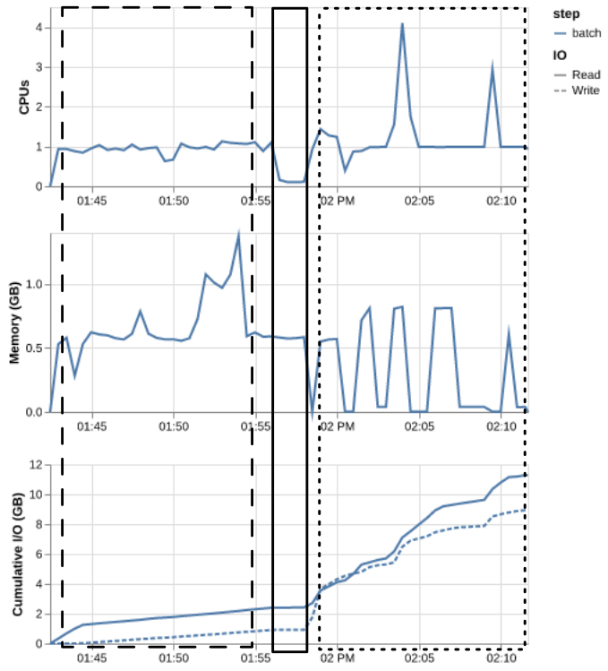

!!! time "wibbly wobbly timey wimey" <!--TODO-->

!!! objectives
    - review the resource utilisation of a previous job
    - identify areas for improvement in job efficiency

!!! prerequisite
    This tutorial assumes familiarity with Mahuika and the use of HPCs. You should be able to:

    - use the terminal to navigate a filesystem
    - find and load software
    - write a Slurm batch script
    - submit batch jobs to Slurm
    - check on the status of queued and completed Slurm jobs

    These tasks are covered in the [Introduction to HPC tutorials](../Introduction_To_HPC/What_Is_an_HPC.md).

This tutorial aims to give you hands on experience evaluating and improving job efficiency.
To do that, we are going to work with an example workflow from genomics, but no genomics knowledge is needed for the tutorial.

The example used here is based on materials from the [Data Carpentry Data Wrangling and Processing for Genomics](https://datacarpentry.github.io/wrangling-genomics/02-quality-control.html#bioinformatic-workflows) and [Genomics Aotearoa Intro to Bash Scripting and HPC Scheduler](https://genomicsaotearoa.github.io/Workshop-Bash_Scripting_And_HPC_Job_Scheduler/) workshops if you want more information.

## Setup

To begin, we will be working with some example scripts that can be found in `/opt/nesi/examples/tutorials/job_scripting`.
You will want to have these files in your `nobackup` directory.
Let's make a directory to work from and copy the files in.

```sh
cd /nesi/nobackup/nesi99991/hpc102
mkdir $USER
cd $USER
cp -r /opt/nesi/examples/tutorials/job_scripting .
```

There are 3 broad steps in this workflow:

1. Quality control
2. Indexing the reference genome
3. Alignment and variant calling

`pipeline.sl` runs them one after another in a single job, with every sample going through each step before the next step starts:


## Looking at a previous job and its efficiency

### `sacct`

??? note "`pipeline.sl`"

    ```sl
    --8<-- "docs/assets/workshops/hpc102/pipeline.sl"
    ```

The example script `pipeline.sl` has already been run as a batch job and has the job ID `{{ intermediate_hpc_job_id_01 }}`.
Let's take a look at the status of that job before we even start looking at the script and see what we can learn.

```sh
sacct -j {{ intermediate_hpc_job_id_01 }}
```

<!-- TODO: update with most recent run -->
```output
JobID           JobName    Elapsed     AveCPU     MinCPU   TotalCPU Al NT     MaxRSS      State 
------------ ---------- ---------- ---------- ---------- ---------- -- -- ---------- ---------- 
9296168      intermed-+   00:29:10                        29:56.822  8                COMPLETED 
9296168.bat+      batch   00:29:10   00:29:57   00:29:57  29:56.822  8  1   1439444K  COMPLETED 
9296168.ext+     extern   00:29:10                         00:00:00  8  1             COMPLETED
```

!!! tip "Changing what `sacct` shows you by default"
    format flags that might be helpful

    stick this in bash profile
    <!-- TODO -->

### `seff`

The basic `sacct` tells us a little about the job: the runtime, how many CPUs were allocated, the final job state.
But this information doesn't really help us evaluate how well the job ran.
To look at the efficiency of our job, we can use the command `seff` (short for **s**lurm **eff**iciency):

```sh
seff {{ intermediate_hpc_job_id_01 }}
```
<!-- TODO: update with most recent run -->

```txt
Job ID: 9296168
State: COMPLETED
Cores: 4
Job Wall-time:         12%  00:29:10 of 04:00:00 time limit
Avg CPU Utilisation:   26%  00:29:57 of 01:56:40 core-walltime
Peak Mem Utilisation:  27%  1.37 GB of 5.00 GB
```

`seff` gives us a lot of the same information but with a bit more context.

!!! question "What resources would you request if resubmitting the job based only on this information?"
    You aren't working with a lot of information yet, but we can take a first stab at how to improve our job efficiency just by adjusting our requested resources.

??? question "Solution: resources for next time"
    We can probably lower the memory and CPUs requested, but if we are doing so, it might be best to leave the job time alone so if the job runs a little slower it doesn't timeout.

<quiz>
<p class=admonition-title>Reading <code>seff</code></p>

`seff` reports `Avg CPU Utilisation: 26%` for a job that requested 4 CPUs. What does that mean?

- [x] Around one of the four CPUs was busy, on average.
- [] Around two of the four were busy (because of simultaneous multithreading).
- [] Each CPU was busy for 26% of the job, so the job needed all four.
> Not necessarily: an average can hide a short burst that used all four CPUs, or long stretches using one.
- [] The job ran for 26% of its time limit.
> That is the `Job Wall-time` line.
</quiz>

This is a good first step, we noticed that we are requesting more resources than we need and can make some quick adjustments.
But this assumes that the resources being used are fairly stable over the script.
The CPU utilisation is just an average, so we don't know if there was a portion of the job that did use all the CPUs we allocated to the job.

### Job profiling

Slurm has the ability to conduct 'profiling' on jobs being submitted.
This stores extra data about the resources the job uses at various times throughout the job and can let you assess your efficiency in more detail.
To enable profiling in a batch job, you need to add the following to your Slurm header:

```sh
#SBATCH --profile=task
```

Luckily for us, this was included in our script when it was run previously, so we can access this data about our job.
We can run `profile_plot {{ intermediate_hpc_job_id_01 }}` to produce a PNG with plots of the CPU, memory and I/O utilisation over the course of our job.


Now we can see things in a bit more detail.

!!! question "What stands out?"
    What more can we learn from these plots? Does this change your thoughts on how to adjust the requested resources?

??? question "Solution"
    - The job has distinct phases, which match the three steps in the script.
    - For most of the job only about one of the four CPUs is busy. The CPU use only briefly reaches four, during alignment.
    - Memory peaks at about 1.4 GB during quality control, and stays well below that for the rest of the job.
    - Reading and writing files grows steadily through the alignment step.

    So reducing the CPUs for the whole job would slow down the short parts that use them,
    while keeping four CPUs wastes them for most of the job.

## Reviewing our job script

Now let's actually take a look at what this job was running.
Let's open `pipeline.sl` and poke around.

!!! tip "Looking at the script based on the job ID"
    If we add the flag `-B` to our `sacct` command, `sacct` will return the script that was called for the job we are interested in.

    ```sh
    sacct -B -j {{ intermediate_hpc_job_id_01 }}
    ```

    Ideally you remember what script was run, but this can be helpful if you aren't sure what you changed since you last ran a job or if you aren't sure which script was actually used.

As mentioned above, this script is doing 3 major steps which are indicated with comments in the script:

1. Quality control
2. Indexing the reference genome
3. Alignment and variant calling

Looking at the profile plot, we can try to identify the steps of the job.



There are two major sections in the profile plot, and one little blip in the middle that we can guess is the reference genome indexing occurring between the quality control and alignment/variant calling steps.

## What we have found

Our job requested 4 CPUs and 5 GB of memory for its whole run, but:

- most of the time it used one CPU,
- each step needs different resources,
- the same steps run one sample after another, in a single long job.

Adjusting the resources of the whole job only helps so much.

!!! keypoints
    - `sacct` and `seff` compare what a job requested with what it used, but only as totals and averages.
    - Profiling shows how a job's use of CPUs, memory and I/O changes over time.
    - Different steps of a job can need different resources.

We've assessed our job on a general scale and made some changes without editing the script at all.
The next step is to work on improving the efficiency of the script itself.

!!! postrequisite "What next"
    - Next lesson: [Using Variables](Using_Variables.md).
    - For reference: [checking job efficiency](../../Batch_Computing/Batch_Computing_Guide.md#checking-job-efficiency)
      and [Slurm Native Profiling](../../Software/Profiling_and_Debugging/Slurm_Native_Profiling.md).
