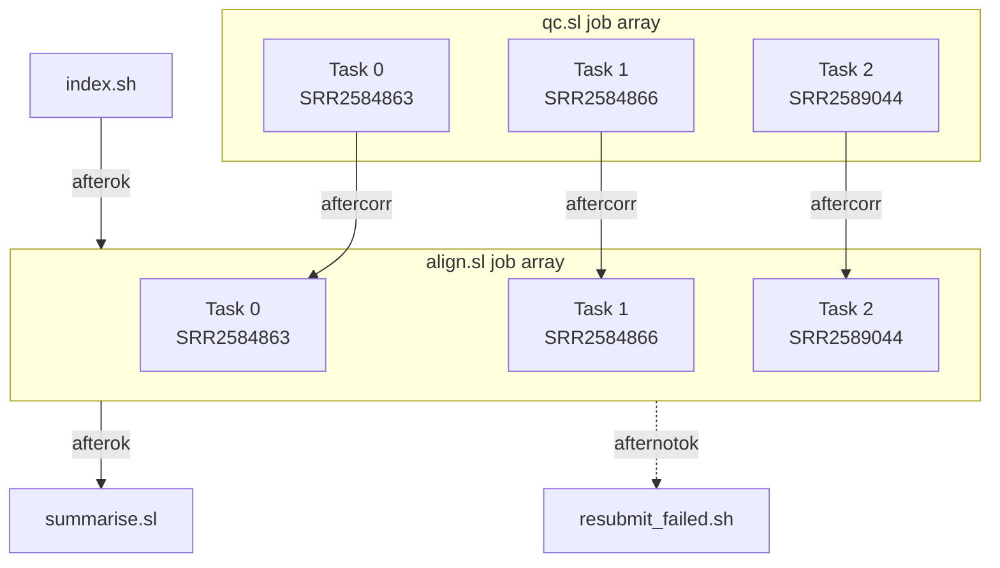

!!! time "45 Minutes"

!!! objectives
    - Convert a Slurm job script into a Slurm job array script
    - Run a whole pipeline, from preparation to a summary, from one submission script.
    - Compare the pipeline's resource use with the job you started with.
    - Recognise when a workflow manager would serve you better than Slurm scripts.

!!! prerequisite
    - You can find why a job failed. See [Debugging Failed Jobs](Debugging_Failed_Jobs.md).

## What is a job array?

Job arrays allow you to use a single script to submit a set of nearly identical SLURM jobs.
Each job in an array is allocated the exact same resources and submitted to the queue simultaneously.
They are the solution to the problem known as *embarrassingly parallel* tasks.
Embarrassingly parallel tasks are those which require no communication or dependency between tasks, meaning they can be run entirely independently of each other.

## Moving from for loops to job arrays

We are going to dissect our job script from the [Evaluating Job Efficiency](./Evaluating_Job_Efficiency.md) and [Using Variables](./Using_Variables.md) tutorials so that it can be submitted as a job array.
The script we will be working from is called `03_script.sl` and should be in the `tutorial_<username>` directory you already created. The contents are also below:

```bash

```

## One job, many samples

In [Job Dependencies](Job_Dependencies.md), `qc.sh` and `align.sh` each work through every sample with a loop,
one sample after another:

```bash
for infile in untrimmed_fastq/*_1.fastq.gz
do
    base=$(basename ${infile} _1.fastq.gz)
    # ... the commands for one sample ...
done
```

The samples don't depend on each other, so they could run at the same time.

!!! question "Why not a job for each sample?"
    Another way would be to submit a separate job for each sample, in a loop.
    This works for three samples. What problems might it cause with hundreds of samples?

??? question "Solution"
    - Every sample is a separate job, with its own job ID, so the jobs are harder to watch or cancel together.
    - Submitting many jobs one by one puts much more load on the scheduler than one job array.
    - It is easy to lose track of which jobs belong to which run.

A *job array* runs the same script many times as one job, with one *task* for each index you give `--array`.
Each task gets its index in the environment variable `SLURM_ARRAY_TASK_ID`, which the script uses to pick its input.

## Converting the scripts

Instead of looping over the raw read files, each task of the array picks one of them.
`files=(untrimmed_fastq/*_1.fastq.gz)` makes a bash *array*: a list of the matching files, in alphabetical order.
`${files[0]}` is the first file, `${files[1]}` the second, and so on, so each task can take the file at its own index:

```bash
files=(untrimmed_fastq/*_1.fastq.gz)
base=$(basename ${files[SLURM_ARRAY_TASK_ID]} _1.fastq.gz)
```

Because the list starts at 0, the task indexes start at 0 too: for three samples, `--array 0-2`.

Here are the quality control and alignment scripts, with the loop replaced by those two lines:

??? note "`qc.sl`"

    ```sl
    --8<-- "docs/assets/workshops/hpc102/.qc_3.sl"
    ```

??? note "`align.sl`"

    ```sl
    --8<-- "docs/assets/workshops/hpc102/.align_3.sl"
    ```

`align.sl` builds the list from the raw read files too, not the trimmed ones, so each task index is the same sample in both scripts.
Indexing (`index.sh`) runs once for all samples, so it stays as it is.

<quiz>
<p class=admonition-title>Output file names</p>

A job array script has `#SBATCH --output log/sample_${SLURM_ARRAY_TASK_ID}.out`. Where do the tasks write their output?

- [x] All of them write to one file, literally named `log/sample_${SLURM_ARRAY_TASK_ID}.out`.
> Slurm reads `#SBATCH` lines before the job starts, so the variable is not replaced. Use `%a` instead.
- [] Task 1 writes to `log/sample_1.out`, task 2 to `log/sample_2.out`, and so on.
> That is what `log/sample_%a.out` does.
- [] The job fails to submit.
</quiz>

## Running the array

Submit a job array with `--array`, giving one task for each raw read file.
Use `%A` (the job ID of the whole array) and `%a` (the task index) in the log file names, so each task writes its own:

```sh
sbatch --array 0-2 --output log/%x_%A_%a.out qc.sl
```

`squeue --me` shows the tasks still waiting together on one line, such as `JOB_ID_[0-2]`, and each running task as `JOB_ID_0`, `JOB_ID_1` and so on.
To check one task, give `seff` the task's ID, for example `seff JOB_ID_1`.
Replace `JOB_ID` with the job ID that `sbatch` printed.

To limit how many tasks run at the same time, add `%` and a number to `--array`. `--array 0-2%2` runs at most two tasks at once.

!!! tip "Don't make each task too small"
    Each task queues and starts like a separate job, and counts towards the queue limit in [Job Limits](../../Batch_Computing/Job_Limits.md).
    If each piece of work takes only a few seconds, group several pieces into each task rather than giving each its own.

## Putting it together

The job array was the last piece. We can now queue the whole workflow, from quality control to a summary, with one command.

### The finished pipeline

This is the final version of `pipeline.sh`, building on the one from [Job Dependencies](Job_Dependencies.md):

```sh
--8<-- "docs/assets/workshops/hpc102/.pipeline_7.sh"
```

For the three samples, it queues two job arrays and three single jobs.
Each alignment task waits for the quality control task with the same index and for indexing. The summary runs if every alignment task succeeds, and the resubmit job runs if any fails:



- Quality control (`qc.sl`) runs as a job array, one task per sample, and indexing (`index.sh`) runs at the same time.
- Alignment (`align.sl`) is a second job array. `aftercorr` starts each of its tasks as soon as the quality control task
  with the same index has succeeded, and `afterok` waits for indexing. The `,` means both conditions must be met.
- `summarise.sl` waits for every alignment task to succeed, then counts the variants found in each sample.
  With `afterok`, a job that depends on a job array waits for every task:

    ```sl
    --8<-- "docs/assets/workshops/hpc102/.summarise.sl"
    ```

- If any alignment task fails, the `resubmit` job runs instead. For a job array, `afternotok` waits until every task has finished and at least one has failed.
  It runs `resubmit_failed.sh`, which finds the failed tasks and submits only those again, with more memory:

    ```sh
    --8<-- "docs/assets/workshops/hpc102/.resubmit_failed.sh"
    ```

  `--wrap` submits a single command as a job, without a batch script.
  If tasks are resubmitted, `summarise.sl` is cancelled, because its dependency can no longer be met, so run it yourself once they finish.

Save the scripts next to each other, then run `bash pipeline.sh` on the login node.

### Compare with where you started

<!-- Write: once the scripts are final, re-run pipeline.sl and the finished pipeline, and compare them here:
time from start to finish, CPU time booked (core-minutes), average CPU use, and memory requested and used. -->

"CPU time booked" is the time each job ran multiplied by the CPU cores it had, which is what counts against your project.

!!! question "Where did the savings come from?"
    Which change, from which lesson, made the biggest difference?

??? question "Solution"
    - Splitting the job ([Job Dependencies](Job_Dependencies.md)) let each step request only what it needs,
      instead of holding four CPUs, 5 GB and four hours for the whole run.
    - The job array (this lesson) runs the samples at the same time, so the pipeline finishes sooner.
    - Passing `${SLURM_CPUS_PER_TASK}` to the tools ([Using Variables](Using_Variables.md)) lets alignment use the CPUs it asks for.

### When to use a workflow manager

A submission script works well for a few steps. As a workflow grows, a *workflow manager* can take over:
you describe each step with its inputs and outputs, and it works out the order, submits the Slurm jobs for you,
and can skip the steps whose results are already up to date.
[Snakemake](../../Software/Available_Applications/snakemake.md) and [Nextflow](../../Software/Available_Applications/Nextflow.md)
are both available on Mahuika.

<quiz>
<p class=admonition-title>Choosing a tool</p>

Which of these suggests it is time to move to a workflow manager?

- [x] You often need to rerun only the stages whose inputs changed.
- [x] Your submission script has grown to many stages, with different dependencies between them.
- [] You need to run the same command on 50 input files.
> A single job array handles that well.
</quiz>

!!! keypoints
    - A short submission script can queue a whole pipeline, with each stage sized for its own needs.
    - Measure before and after: the same work can use far fewer resources.
    - Workflow managers take over when pipelines outgrow scripts.

!!! postrequisite "What next"
    - [Snakemake](../../Software/Available_Applications/snakemake.md) and [Nextflow](../../Software/Available_Applications/Nextflow.md) on Mahuika.
    - For reference: [Job Dependencies](../../Batch_Computing/Job_Dependencies.md) and [Job Arrays](../../Batch_Computing/Job_Arrays.md).
