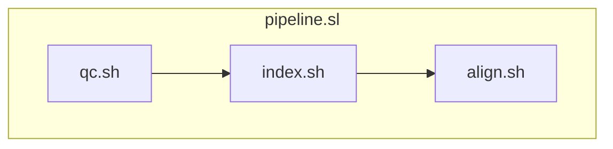
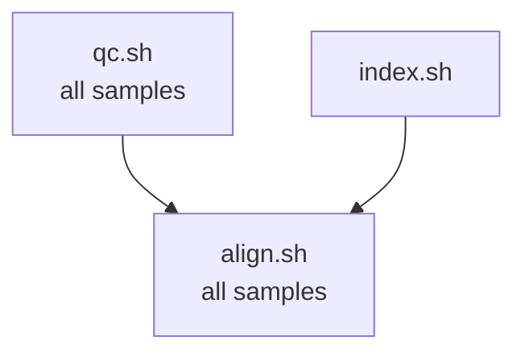

!!! time "45 Minutes"

!!! objectives
    - Split a job into parts that each request only the resources they need.
    - Make a job wait for another job with `--dependency`.
    - Queue a whole workflow from one submission script.

!!! prerequisite
    - You will need `pipeline.sl` as set up in [Using Variables](Using_Variables.md).

## One script per stage

The steps of `pipeline.sl` have different resource needs:

1. Quality control
2. Indexing the reference genome
3. Alignment and variant calling

Even so, `pipeline.sl` runs every step, for every sample, in one job that holds 4 CPUs, 5 GB and 4 hours the whole time.
Before we can give each step its own resources, each step needs to be a script of its own.

!!! question "Move quality control into its own script"
    Move the quality control part of `pipeline.sl`, with its loop and the variables it uses, into a new script, `qc.sh`.

??? question "Solution"
    `qc.sh` is the quality control section of `pipeline.sl`, with `adapters` moved in from the top:

    ```bash
    --8<-- "docs/assets/workshops/hpc102/.qc_1.sh"
    ```

!!! question "Do the same for indexing and alignment"
    Move reference genome indexing into `index.sh`, and alignment and variant calling into `align.sh`.

??? question "Solution"
    `index.sh` indexes the reference genome:

    ```bash
    --8<-- "docs/assets/workshops/hpc102/.index_1.sh"
    ```

    `align.sh` also creates the results folders, which `pipeline.sl` did between the steps.
    It unzips each sample's trimmed reads inside the loop, so it loops over the zipped files:

    ```bash
    --8<-- "docs/assets/workshops/hpc102/.align_1.sh"
    ```

The step scripts don't load any modules: run with `bash` from `pipeline.sl`, they use the modules it has already loaded.

### Running the steps in one job

`pipeline.sl` still runs the same steps in the same order, in one job, but now calls a script for each:

```sl
--8<-- "docs/assets/workshops/hpc102/.pipeline_4.sl"
```

It runs `qc.sh`, then `index.sh`, then `align.sh`, each working through every sample:



## Split by resource needs

Each step is now a script of its own, but `pipeline.sl` still runs them all in one job,
holding 4 CPUs, 5 GB and 4 hours for every step.

!!! question "Splitting tasks by resource needs"
    Let's give each step script (`qc.sh`, `index.sh` and `align.sh`) an appropriate resource request,
    based on the profile from [Evaluating Job Efficiency](Evaluating_Job_Efficiency.md), so each can run as a separate job.

??? question "Solution: updated scripts"
    There is no one correct answer here! But here is one option.
    The profile plot in [Evaluating Job Efficiency](Evaluating_Job_Efficiency.md#reviewing-our-job-script) shows the steps of the job:
    quality control first, a short blip that is probably indexing the reference genome, then alignment and variant calling.

    So we can give the three scripts better resource requests. Each still works through every sample,
    and writes its output to `log/`, like `pipeline.sl` since [Using Variables](Using_Variables.md#output-files).

    **Quality control**:`qc.sh` requests fewer CPUs, less memory and much less time.

    ```sl
    --8<-- "docs/assets/workshops/hpc102/.qc_2.sh"
    ```

    **Reference genome indexing**: `index.sh` requests less CPUs, memory, and time.

    ```sl
    --8<-- "docs/assets/workshops/hpc102/.index_2.sh"
    ```

    **Alignment and variant calling**: `align.sh` requests the same CPUs but less memory and time.

    ```sl
    --8<-- "docs/assets/workshops/hpc102/.align_2.sh"
    ```

Quality control requests two CPUs, indexing one, and alignment four.
Indexing doesn't need the results of quality control either, so those two jobs can run at the same time.

<!-- Write: re-record these three plots with the three jobs from pipeline.sh, and update the text below to match. -->


Once each script has run, check it with `seff` and adjust its request, leaving 20 to 30% spare as in the
[Introduction to HPC](../Introduction_To_HPC/Resources.md).

## Read and write less (claude wrote this, not sure if true)

The profile plot showed reading and writing files growing steadily through alignment.
For each sample, `align.sh` writes a `.sam` file (`${sam}`), converts it to a `.bam` file (`${bam}`), then sorts that into another (`${sorted_bam}`).
Only the sorted file is used afterwards.

!!! question "Skip the intermediate files"
    `samtools sort` can read from a pipe (`|`) as well as from a file.
    How could the alignment write straight into `samtools sort`, without the `.sam` and unsorted `.bam` files?

??? question "Solution"
    Pipe `bwa-mem2` into `samtools sort`, which reads from the pipe when given `-` as its input file:

    ```bash
    bwa-mem2 mem -t ${SLURM_CPUS_PER_TASK} ${ref_genome} ${fq1} ${fq2} \
        | samtools sort -@ ${SLURM_CPUS_PER_TASK} -m 256M -o ${sorted_bam} -
    ```

    Both commands now run at the same time, so the job needs more memory.
    In our tests this step used up to about 2.5 GB, so request `--mem 3G`.

For large temporary files, see also [Temporary Directories](../../Batch_Computing/Temporary_Directories.md).

## Make a job wait for another

Alignment can only start once quality control and indexing have finished.
Rather than waiting to submit `align.sh` by hand, we can submit it straight away and tell Slurm to wait, with `--dependency`:

```sh
sbatch --dependency afterok:JOB_ID align.sh
```

Replace `JOB_ID` with the job ID of the job to wait for.
To wait for more than one job, separate the job IDs with `:`, for example `afterok:JOB_ID_1:JOB_ID_2`.

The condition decides what the job waits for:

| Condition | The job can start when the listed jobs have |
| --------- | ------------------------------------------- |
| `afterok` | finished successfully. |
| `afternotok` | finished in a failed state. |
| `afterany` | finished, in any state. |
| `after` | started. |

If a job you depend on fails, a job waiting with `afterok` can never run, and Mahuika cancels it.

<quiz>
<p class=admonition-title>Dependencies</p>

Job `1001` is running and job `1002` has failed. Which of these jobs can start once their dependency is checked?

- [x] `--dependency after:1001`
> `after` only needs job `1001` to have started.
- [] `--dependency afterok:1002`
> Job `1002` failed, so this job can never start. Mahuika cancels it.
- [x] `--dependency afternotok:1002`
> `afternotok` waits for the job to fail, which it has.
- [] `--dependency afterok:1001`
> Job `1001` is still running. This job waits until it finishes successfully.
</quiz>

## Queue a whole workflow

`pipeline.sl` already runs a script for each step. If it submits each step with `sbatch` instead of running it with `bash`,
every step becomes a job of its own.
`sbatch --parsable` prints only the job ID, so the script can save it and use it in the next submission:

```sh
--8<-- "docs/assets/workshops/hpc102/.pipeline_6.sh"
```

It queues three jobs, each with its own resources.
Quality control and indexing can start straight away. Alignment waits, with `afterok`, for both to succeed:



The script is no longer a batch job itself: it has no `#SBATCH` header, and only submits the other jobs, so it finishes straight away.
Save it as `pipeline.sh` next to the three scripts, and run it on the login node with `bash pipeline.sh`.
`squeue --me` then shows the alignment job waiting, with the reason `(Dependency)`, until the jobs they depend on have finished.

!!! question "Why queue every step at once?"
    What is gained by submitting the later steps straight away, rather than waiting to submit them by hand?

??? question "Solution"
    Each step can start as soon as the steps it depends on have succeeded, without you being there to submit it.
    The whole workflow runs from one command.

Quality control and alignment still work through the samples one after another, inside one job each.
The samples don't depend on each other, so the next lesson runs them at the same time, as a job array.

!!! keypoints
    - A script for each step lets each step run as its own job.
    - Split a job where its parts need different resources.
    - `--dependency afterok:JOB_ID` makes a job wait for another to finish successfully.
    - `sbatch --parsable` gives the job ID, so a script can queue a whole workflow.

!!! postrequisite "What next"
    - Next lesson: [Job Arrays](Job_Arrays.md).
    - For reference: [Job Dependencies](../../Batch_Computing/Job_Dependencies.md)
      and [Temporary Directories](../../Batch_Computing/Temporary_Directories.md).
