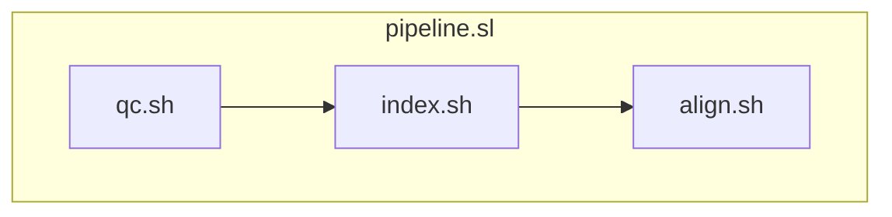

!!! time "30 Minutes"

!!! objectives
    - Read a `for` loop that runs commands on each file
    - Use variables to make a script reusable
    - Use variables to improve script robustness
    - Use variables to improve script readability

!!! prerequisite
    This tutorial assumes familiarity with Mahuika and the use of HPCs. You should be able to:

    - use the terminal to navigate a filesystem
    - find and load software
    - write a Slurm batch script
    - submit batch jobs to Slurm
    - check on the status of queued and completed Slurm jobs

    These tasks are covered in the [Introduction to HPC tutorials](../Introduction_To_HPC/What_Is_an_HPC.md).

## Summary and setup

This tutorial aims to give you hands-on experience using variables in Slurm job scripts.
To do that, we are going to work with an example script from genomics, but no genomics knowledge is needed for the tutorial. 

The example used here is based on materials from the [Data Carpentry Data Wrangling and Processing for Genomics](https://datacarpentry.github.io/wrangling-genomics/02-quality-control.html#bioinformatic-workflows) if you want more information.

You don't need to have completed the [Evaluating Job Efficiency tutorial](./Evaluating_Job_Efficiency.md). We will be improving `pipeline.sl`, the script from that lesson. If you haven't already, please follow the setup instructions in the box below to get all the files needed to run the scripts in this tutorial.

??? note "Setup instructions"
    We will be working with some example scripts that can be found in `/opt/nesi/examples/tutorials/job_scripting`.
    We will be working with some example scripts that can be found in `/opt/nesi/examples/tutorials/job_scripting`.
    You will want to have these files in your `nobackup` directory.
    Let's make a directory to work from and copy the files in.

    ```bash
    cd /nesi/nobackup/nesi99991/hpc102
    mkdir $USER
    cd $USER
    cp -r /opt/nesi/examples/tutorials/job_scripting .
    ```

The script we will be working from, `pipeline.sl`, is below:

```sl
--8<-- "docs/assets/workshops/hpc102/pipeline.sl"
```

This script already uses variables in the for loop with `$infile` and `$base`.
The `for` loop runs its commands once for each file that matches `trimmed/*_1.trim.fastq`, with `$infile` set to that file.
The line `base=$(basename ${infile} _1.trim.fastq)` runs the command inside `$( )` and stores its output in `base`.
`basename` removes the directory and the ending, so for `trimmed/SRR2584863_1.trim.fastq`, `$base` is `SRR2584863`.
But how can they help us improve our script further?

Using variables helps with several aspects of writing and using code.
Variables can help with ensuring our script is readable, reusable and robust.

## Formatting variables

You will likely see variables called several different ways: `$var`, `${var}` and `"${var}"` are all common options.
All of these are technically correct, and in some situations you can use whatever option you want.
BUT, in some situations how you format your variable calls makes a difference.

In some cases, it can be unclear where your variable ends and where any adjacent string begins.
To help with that, we can wrap the variable name in curly braces: `${var}`.

```bash
ls
```

```output
01sample.txt  02sample.txt
```

```bash
number=01
wc $numbersample.txt
```

```output
wc: .txt: No such file or directory
```

Instead of combining our variable (`01`) with the rest of the filename (`sample`), bash has instead used what it has stored in the variable `$numbersample` which is currently nothing.

```bash
wc ${number}sample.txt
```

```output
0 0 0 01sample.txt
```

<quiz>
<p class=admonition-title>Braces in our script</p>

In `pipeline.sl`, `$base` is set to `SRR2584863`. What does this print?

```bash
echo $base_1.trim.fastq
```

- [x] `.trim.fastq`
> Bash reads the variable name as `base_1`, which is not set, so it expands to nothing.
- [] `SRR2584863_1.trim.fastq`
> That needs braces: `${base}_1.trim.fastq`, as the script uses.
- [] An error, because `base_1` is not set.
> Bash carries on silently, unless the script uses `set -u` (see below).
</quiz>

Using quotations around a call of a variable name can help avoid issues caused by spaces or other special characters in the variable.
For example, if we try to use a variable to create a directory with a space in the name, we run into issues that don't immediately raise any errors.

```bash
dir="Folder Name"
mkdir $dir
ls
```

```output
Folder  Name
```

Instead of creating a directory called 'Folder Name', bash instead interpreted the command as `mkdir Folder Name` and created two directories: `Folder` and `Name`.

```bash
mkdir "$dir"
ls
```

```output
 Folder  'Folder Name'   Name
```

<quiz>
<p class=admonition-title>Quotes</p>

What happens when you run these commands?

```bash
file="my data.txt"
wc -l $file
```

- [x] `wc` looks for two files, `my` and `data.txt`.
> Without quotes, bash splits the value at the space. `wc -l "$file"` counts the lines in `my data.txt`.
- [] `wc` counts the lines in `my data.txt`.
> That needs quotes: `wc -l "$file"`.
- [] Bash stops with an error about the space.
</quiz>

## Variables in file paths

Let's use variables to help make the for loop more readable.
We will define our filenames once, and then use variables to call the files where they are needed.

For each loop we have the following files, almost all of which are used multiple times:

- `$infile`: `trimmed/${base}_1.trim.fastq` and its partner `trimmed/${base}_2.trim.fastq`
- the reference genome: `ref_genome/ecoli_rel606.fasta`
- the aligned `.sam`
- the aligned `.bam`
- the sorted `.bam`
- the `.bcf`
- the `.vcf`
- the `.var.vcf`

!!! question "Rewrite the loop"
    Before reading on, try rewriting the loop in `pipeline.sl` so that each of these files has a variable,
    set once at the start of the loop, and the commands use the variables.

Let's give each of these a simple but unique name, and see how the for loop looks.

```bash
--8<-- "docs/assets/workshops/hpc102/.pipeline_2.sl:42:63"
```

The quality control loop gets the same treatment. With every path written from the folder the job runs in,
the `cd` lines are no longer needed, and FastQC's reports go to `results/fastqc` instead of in with the raw data.

??? note "`pipeline.sl` with variables"

    ```sl
    --8<-- "docs/assets/workshops/hpc102/.pipeline_2.sl"
    ```

Our for loop is definitely longer, but the commands are easier to read because we don't need to sift through the file paths to know what file is being used where.
Beyond readability, this also helps reduce errors and make any errors that do occur easier to fix.

!!! question "One more improvement"
    One of these variables is set to the same value every time the loop runs. Which one, and where could it go instead?

??? question "Solution"
    `ref_genome` is the same for every sample, so it can be set once, before the loop starts.

Let's compare the impact of a simple typo in each version of this loop. For example, what if I miss a letter when typing in the path for the `.sam` file?

Without variables this returns:

```txt
[E::hts_open_format] Failed to open file "results/sam/SRR2584863.aligned.sam" : No such file or directory
samtools view: failed to open "results/sam/SRR2584863.aligned.sam" for reading: No such file or directory
```

!!! question "Exercise"
    In the original script, the path for `.sam` is written out twice.
    Which call of the `.sam` file had the typo that created that error?

??? question "Answer"
    The typo was made in the `bwa-mem2` call where the `.sam` file was created, which means the `samtools view` call requests a file that doesn't exist.

When we use variables, the same mistake in the `.sam` variable (`sam=results/sam/${base}.aliged.sam`) does not stop the script:
every command uses the same misspelled path, so the file is named wrongly, but consistently.
And instead of needing to search for which call of the `.sam` path is incorrect, there is only one place that the path is defined.

## Unset variables

A different typo is harder to spot: misspelling the name of a variable.
If a script uses `${smaple}` instead of `${sample}`, bash quietly replaces it with nothing, and the command uses the wrong path without any error.

Adding `set -u` near the top of a script makes it stop as soon as it uses a variable that has not been set,
with an error such as `smaple: unbound variable`.

```bash
set -u
```

The `-e` in `#!/bin/bash -e` does the same for commands: the script stops at the first command that fails,
instead of carrying on without the files that command should have made.

<quiz>
<p class=admonition-title>Unset variables</p>

A script starts with `set -u`, then runs `mkdir "${resluts}/vcf"`, misspelling `results`. What happens?

- [x] The script stops with the error `resluts: unbound variable`.
- [] It tries to create `/vcf`, at the top of the filesystem.
> That is what happens without `set -u`, as the misspelled variable expands to nothing.
- [] It creates `results/vcf`.
</quiz>

## Environment variables

In addition to defining variables ourselves, there are also variables that are defined by the operating system and software.
We can use these to make scripts flexible for use by other users or in other contexts.
Rather than having to update your script to run in a new environment etc, we can have the script adapt to the new environment automatically.

### Matching threads to CPUs

In this case, we are going to make sure that the software we are running knows how many CPUs are available to it.
Currently, we pass the argument `-t 4` to the command `bwa-mem2 mem`.
This argument tells `bwa-mem2` how many threads it can use, and we want it to be able to use as many threads as are available to it.
Currently, if we change the number of CPUs we are requesting, we need to change this argument to see any difference in the behaviour of `bwa-mem2`.
But Slurm has an environment variable called `$SLURM_CPUS_PER_TASK` that can be used to pass this information programmatically.
We can update our for loop to use this variable:

```bash
--8<-- "docs/assets/workshops/hpc102/.pipeline_3.sl:46:66"
```

??? note "`pipeline.sl` so far, with `set -u` and the reference genome set once"

    ```sl
    --8<-- "docs/assets/workshops/hpc102/.pipeline_3.sl"
    ```

Now if we request more CPUs for this job, `bwa-mem2` will have access to all the CPUs allocated.
Slurm only sets `$SLURM_CPUS_PER_TASK` when the job requests `--cpus-per-task`, as this script does.
Slurm sets its variables only inside a job, so they are empty if you try them on the login node.

<quiz>
<p class=admonition-title>Where Slurm variables exist</p>

You run `echo ${SLURM_CPUS_PER_TASK}` on the login node. What do you see?

- [x] An empty line.
> Slurm only sets this variable inside a job, and only when the job requests `--cpus-per-task`.
- [] The number of CPUs on the login node.
- [] The number of CPUs your last job requested.
</quiz>

!!! question "Check that it works"
    Submit the updated script with `sbatch pipeline.sl`, and once it has finished, check it with `seff JOB_ID`.
    Then submit it again with `sbatch --cpus-per-task 2 pipeline.sl`, and compare the elapsed time.

    Replace `JOB_ID` with the job ID that `sbatch` printed.

!!! question "Which other commands could use the CPUs?"
    `bwa-mem2` is not the only command in the loop that can use more than one CPU.
    Check the documentation for `samtools sort`: how could it use the CPUs too?

??? question "Solution"
    `samtools sort` has a `-@` option for the number of threads.
    Each thread uses up to 768 MB of memory by default, so also limit that with `-m` to stay within the job's memory:

    ```bash
    samtools sort -@ ${SLURM_CPUS_PER_TASK} -m 200M ${bam} -o ${sorted_bam}
    ```

### Other useful variables

There are lots of environment variables that can be useful in scripts:

| Variable name | Meaning | Potential use |
| ------------- | ------- | ------------- |
| `$USER` | The username of the current user | Paths that work for everyone, such as `/nesi/nobackup/nesi99991/$USER` |
| `$HOME` | The path to the user's home directory | Finding your own configuration files or scripts |
| `$PWD` | Present Working Directory | Recording where a job ran |
| `$SHELL` | The path to the current shell interpreter | Checking which shell a script runs in |
| `$PATH` | Directories searched for executable commands | Checking which programs a loaded module has made available |
| `$HOSTNAME` | The network name of the machine (within a job this will be the compute node being used) | Recording which node a job ran on |

### Slurm variables

Slurm has some specific environment variables that it sets when running a job as well.

| Variable name | Meaning | Potential use |
| ------------- | ------- | ------------- |
| `$SLURM_JOB_ID` | ID for the current job | Useful for naming output files that won't clash. |
| `$SLURM_JOB_NAME` | Name of the job | Could be used for creating files/directories with useful names |
| `$SLURM_ARRAY_TASK_ID` | The current index of your job array | Helpful when writing job arrays |
| `$SLURM_CPUS_PER_TASK` | Number of CPUs | Useful as an input for multithreaded functions. |
| `$SLURM_NTASKS` | Number of tasks | Useful as an input for MPI functions. |
| `$SLURM_SUBMIT_DIR` | Directory where `sbatch` was called. | Helpful for being able to use relative paths |

!!! warning "Variables in `#SBATCH` lines"
    `#SBATCH` lines are read by Slurm before the job starts, not by bash, so variables in them are not replaced.
    `#SBATCH --output ${SLURM_JOB_ID}.out` creates a file literally named `${SLURM_JOB_ID}.out`.
    Use tokens instead, such as `%j` for the job ID and `%x` for the job name, as in [Output files](#output-files).

!!! tip "Finding out about more useful environment variables"
    You can't use environment variables that you don't know about!
    So how can we learn about new environment variables that might help us?

    One option is the classic advice to RTFM (read the frickin manual).
    Lots of documentation includes information about environment variables that are set or used by the software/tool.
    For example, the samtools documentation includes a section called ['Environment variables'](https://www.htslib.org/doc/samtools.html#ENVIRONMENT_VARIABLES) which includes paths to reference files and plugins that can be used.

    Another option is to look at what environment variables exist in your current environment.
    Running the command `env` will print out the details of your environment, and can be a little overwhelming.
    You can combine `env` with the command `grep` to search and narrow things down.
    For example, after loading the SAMtools module, we can use `env | grep SAM` to only get results that include the string `SAM`.

### Output files

`pipeline.sl` doesn't say where to put its output, so Slurm writes everything to one file,
`slurm-JOB_ID.out`, in the folder the job was submitted from. With many jobs, these files soon pile up and are hard to tell apart.

Adding `--output` to the header puts each job's output in `log/`, named after the job name (`%x`) and job ID (`%j`):

```sl
#SBATCH --output        log/%x_%j.out
```

For `pipeline.sl`, that is `log/intermed-hpc-01_JOB_ID.out`.
Slurm doesn't create the `log` folder, so create it before submitting with `mkdir -p log`.
From here on, `pipeline.sl` has this line.

## One script per stage

`pipeline.sl` still runs every step, for every sample, in one job that holds 4 CPUs and 5 GB the whole time.
Before we can give each step its own resources ([Job Dependencies](Job_Dependencies.md)),
or run the samples at the same time ([Job Arrays](Job_Arrays.md)), each step needs to be a script of its own,
and the steps that work on one sample need to be told which sample.

Anything after a script's name is passed to the script, where the first value is `$1`:

```bash
bash align.sh SRR2584863
```

So we split `pipeline.sl` into three scripts, one for each step

- `qc.sh` does quality control for the sample it is given.
- `index.sh` indexes the reference genome, once for all samples.
- `align.sh` aligns and calls variants for the sample it is given.

??? note "`qc.sh`"

    ```bash
    --8<-- "docs/assets/workshops/hpc102/.qc_1.sh"
    ```

??? note "`index.sh`"

    ```bash
    --8<-- "docs/assets/workshops/hpc102/.index_1.sh"
    ```

??? note "`align.sh`"

    ```bash
    --8<-- "docs/assets/workshops/hpc102/.align_1.sh"
    ```

In `qc.sh` and `align.sh`, `base="$1"` takes the place of the loop.
The step scripts don't load any modules: run with `bash` from `pipeline.sl`, they use the modules it has already loaded.
Because of `set -u`, running one of them without a sample name stops it straight away, with `$1: unbound variable`.

### Running the steps in one job

For now, a new batch script, `pipeline.sl`, runs the steps in one job, one sample after another.
Run with `bash` inside a job, a script's `#SBATCH` lines are only comments, so each step uses the resources of `pipeline.sl`:

```sl
--8<-- "docs/assets/workshops/hpc102/.pipeline_4.sl"
```

`pipeline.sl` now calls the step scripts: `index.sh` once, then `qc.sh` and `align.sh` for each sample in `samples.txt`, all inside the one job:


```

!!! question "Process another sample"
    How would `pipeline.sl` run quality control for just the sample `SRR2589044`?

??? question "Solution"
    ```bash
    bash qc.sh SRR2589044
    ```

Any `#SBATCH` option can also be given on the `sbatch` command line, before the script name.
Options on the command line override the same option in the script, which is how `sbatch --cpus-per-task 2 pipeline.sl`
ran the script with 2 CPUs earlier, without editing it.

<quiz>
<p class=admonition-title>Command line or script</p>

`pipeline.sl` has `#SBATCH --mem 5G`. You submit it with `sbatch --mem 8G pipeline.sl`.
How much memory does the job get?

- [x] 8G, because options on the command line override the script.
- [] 5G, because the script is read last.
- [] 13G, because the two are added together.
</quiz>

!!! question "Run it"
    Submit `pipeline.sl` with `sbatch pipeline.sl`, and once it has finished, check how it ended with `sacct`.

??? question "What happened?"
    The job failed. Finding out why is the subject of the next lesson, [Debugging Failed Jobs](Debugging_Failed_Jobs.md).

!!! keypoints
    - Using variables can help make code more readable and robust to errors
    - Using environment variables can help make your code more portable
    - Braces and quotes make variables expand the way you expect
    - `set -u` stops a script when it uses a variable that is not set
    - A script for each step, taking the sample as an argument, lets each step later run as its own job
    - A `for` loop runs the same commands on each file
    - Options on the `sbatch` command line override the same option in the script
    - Variables do not work in `#SBATCH` lines. Use tokens like `%x` and `%j`

!!! postrequisite "What next"
    - Next lesson: [Debugging Failed Jobs](Debugging_Failed_Jobs.md).
    - For reference: the [Batch Computing Guide](../../Batch_Computing/Batch_Computing_Guide.md)
      and the [Slurm Reference Sheet](../../Getting_Started/Cheat_Sheets/Slurm-Reference_Sheet.md).
    - For more shell practice: the Software Carpentry [Unix Shell](https://swcarpentry.github.io/shell-novice/) lessons on loops and shell scripts.
